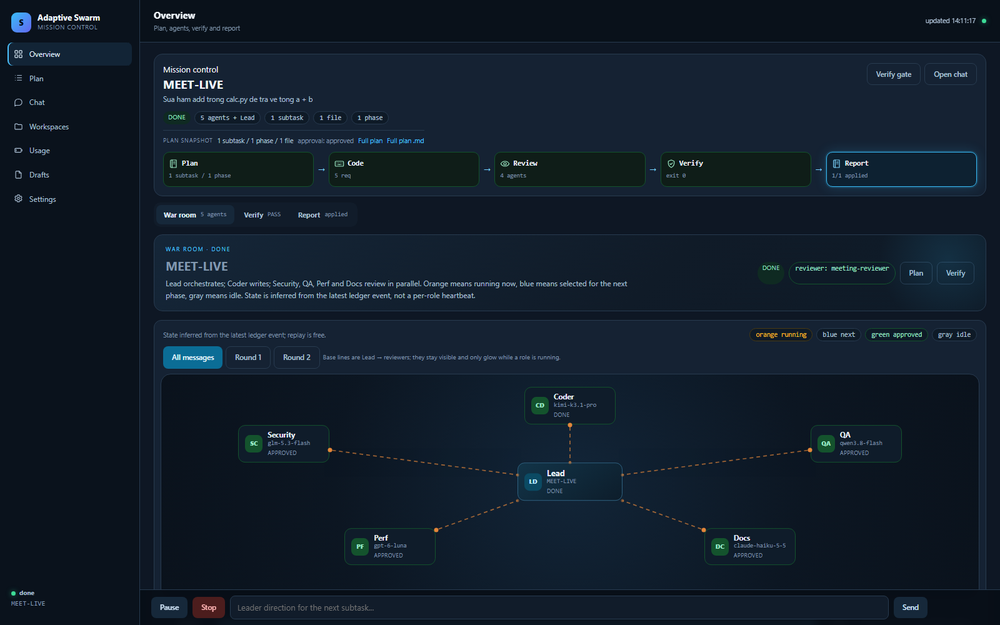

# Adaptive Swarm Pipeline

[](https://github.com/khoacat12345/adaptive-swarm-pipeline/actions/workflows/cross-platform.yml)
[](LICENSE)
[](https://www.python.org/downloads/)
[](docs/OPENCODE_SKILL_SETUP.md)

**The Autonomous Multi-Agent Software Firm in Your Terminal.**

Adaptive Swarm is an embeddable agent skill and verification-first execution harness for [OpenCode](https://opencode.ai). Multiple AI models (DeepSeek, GLM, Nemotron) debate, plan, code, and review in an isolated Git worktree — with real-time Blackboard deliberation, strict budget guards, and zero risk to your repository.

> **One-Command Deliberation:** Inside OpenCode, simply type `/swarm <task>` to unleash the multi-agent council.



A **verification-first** coding harness for [OpenCode](https://opencode.ai):
several AI models work as one team, but nothing is written to your project unless a
real machine check passes.

> Status: **v3.0.0 — Unified Engine release**.
> `swarm "task"` is the official entrypoint; the v2 runner is the default
> execution heart. `v1.0.5` remains available as a frozen fallback tag.
> The release includes live free-model smoke, a 459/459-cycle fake-mode 8-hour soak,
> crash/resume, rollback, parity fixtures, and the unified War Room at
> `127.0.0.1:8501`.
> Original acceptance on Windows; Linux/macOS paths are supported and covered
> by the cross-platform CI workflow.
>
> Built with AI assistance; every change is machine-verified.

## v3.0.0 — Unified Engine

The unified architecture is:

```text
swarm CLI / OpenCode / War Room (8501)
                  │
                  ▼
          UnifiedOrchestrator
   preflight → tier → planner → Usage
                  │
                  ▼
              v2 Runner
   worktree + budget + adaptive bundle
                  │
                  ▼
   verify → checkpoint → handoff
                  │
        explicit merge / rollback
```

- **One entrypoint:** `swarm "task"` (terminal) or `/swarm <task>` (OpenCode).
- **E1–E4 execution tiers:** coder-only, coder+security, four-reviewer wave,
  and E4 blackboard meeting.
- **Planner P1–P3:** one, two, or three planning seats by tier.
- **One War Room:** `http://127.0.0.1:8501`; `--port 8080` remains an alias.
- **Explicit delivery:** merge and rollback are operator commands; execution
  never auto-merges.
- **Frozen v1:** commands and tag `v1.0.5` remain as an emergency oracle; new
  users should use `swarm`.

```powershell
# New user flow (Windows; POSIX uses ./swarm.sh)
python .agents\scout.py --write --verify
.\swarm.cmd doctor
.\swarm.cmd "fix the failing add() test"

# Inspect / deliver
.\swarm.cmd status --last
.\swarm.cmd merge --run-id <id>
.\swarm.cmd rollback --run-id <id>
```

Add the repository root to `PATH` if you prefer the bare `swarm` command
(`./swarm.sh` on Linux/macOS).

### Delivery and release boundary

- **v3.0.0** is the default product engine (`swarm` + v2 runner).
- **v1.0.5** is frozen fallback/test-oracle; do not use `job.py`/`recipe_c.py`
  as the new-user interface.
- Git worktree protects **files**, not the OS; v3 does not claim a container/VM
  sandbox. Use an external sandbox for untrusted workloads.
- The five adaptive capabilities (repo map, read-only ACI, failure lessons,
  bounded tiered memory, event runtime) are integrated across E1–E4.

Operator guide: [`docs/OPERATOR_GUIDE.md`](docs/OPERATOR_GUIDE.md).
Unified engine migration plan:
[`docs/UNIFIED_ENGINE_MASTERPLAN.md`](docs/UNIFIED_ENGINE_MASTERPLAN.md).
V1 feature parity audit:
[`docs/V1_FEATURE_PARITY.md`](docs/V1_FEATURE_PARITY.md).
Blind evaluation spec:
[`docs/BLIND_EVALUATION_SPEC.md`](docs/BLIND_EVALUATION_SPEC.md).
Spec Kit adoption: [`docs/SPEC_KIT_ADOPTION.md`](docs/SPEC_KIT_ADOPTION.md).
Legacy v2 foundation spec: [`docs/SWARM_V2.1_SPEC.md`](docs/SWARM_V2.1_SPEC.md). Constitution:
[`docs/CONSTITUTION.md`](docs/CONSTITUTION.md). Tasks schema:
[`docs/schemas/tasks.schema.json`](docs/schemas/tasks.schema.json). Release
notes: [`docs/RELEASE_NOTES.md`](docs/RELEASE_NOTES.md) (historical
[`RELEASE_v2.1.0.md`](docs/RELEASE_v2.1.0.md)). Known gaps and status:
[`docs/OPEN_PROBLEMS.md`](docs/OPEN_PROBLEMS.md). Research
shortlist: [`docs/RESEARCH_BACKLOG.md`](docs/RESEARCH_BACKLOG.md). Adaptive
primitives: [`docs/ADAPTIVE_TOOLKIT.md`](docs/ADAPTIVE_TOOLKIT.md). Integration
plan: [`docs/SKILL_INTEGRATION_PLAN.md`](docs/SKILL_INTEGRATION_PLAN.md).
Shadow pilot: [`docs/SHADOW_PILOT_REPORT.md`](docs/SHADOW_PILOT_REPORT.md).
Live pilot: [`docs/LIVE_PILOT_REPORT.md`](docs/LIVE_PILOT_REPORT.md).

## Why

Most coding agents trust themselves. This one does not.

- **Verified apply** — a change is written only if `verify_command` exits `0`.
- **Atomic multi-file transaction** — Level 3 backs up every target first, writes all,
  verifies the whole project, then commits or rolls back *all* files to their exact bytes.
- **Crash recovery** — a journal in `.agents/tmp/tx/` lets the next run roll back an
  interrupted transaction.
- **Cross-family review** — the reviewer must come from a different model family than
  the coder, so it cannot rubber-stamp its own work.
- **Hard budget** - soft 8 / hard 16 requests / 600 seconds per run; fallback switches models inside
  the same call on 429/5xx/timeout.
- **Catalog-aware routing** �?" `scout` discovers local models; `router` selects from
  the local catalog and no longer assumes OpenCode Go is available.
- **Quota-aware routing** — reads real spend from `opencode stats`, tracks the shared
  plan budget *and* per-model caps, then picks main -> abundant escalate -> cheap/free.
- **Append-only ledger** — every event is evidence; replay, dashboard and memory read
  the same source.
- **Single writer** — only the Lead writes project files, always through `safe_writer`.

## Install (Windows / Linux / macOS)

Requirements: Python 3.11+ (3.12 recommended), Git, and the OpenCode CLI in `PATH`.

```bash
git clone https://github.com/khoacat12345/adaptive-swarm-pipeline.git
cd adaptive-swarm-pipeline
```

### Per machine

```bash
# Linux/macOS
python3 .agents/scout.py --write --verify   # free-only; pings main + 4 reviewers
python3 .agents/scout.py --write --allow-paid --verify  # paid opt-in

# Windows PowerShell
python .agents\scout.py --write --verify
python .agents\scout.py --write --allow-paid --verify
```

New installs are **free-only** by default. Paid models are never selected unless
you explicitly pass `--allow-paid`. This includes the `opencode-go/*`
subscription; `scout` reads `opencode auth list` so a stored Go credential is
not misreported as unconfigured. `config.json` stays machine-local and is not
committed.

### Per project

Copy the source `.agents/` and `.opencode/` folders into the project, then run
`scout --write` and the acceptance smoke test.

```bash
python3 .agents/tests/test_phase4.py --fast
```

### OpenCode skill setup (required for `/swarm`)

A fresh clone already includes the skill and command:

```text
.opencode/skills/adaptive-swarm-pipeline/SKILL.md
.opencode/commands/swarm.md
```

Start OpenCode from the project root, then use one of:

```text
/swarm fix the failing add() test
@adaptive-swarm-pipeline fix the failing add() test
```

Verify the installed copy any time:

```powershell
python .agents\sync_skill.py --check
python .agents\tests\test_skill_consistency.py
```

User-wide install (optional):

```powershell
python .agents\sync_skill.py --global --write
```

If you use a global skill, copy `.opencode/commands/swarm.md` to
`~/.config/opencode/commands/swarm.md` to keep `/swarm` available everywhere.
Do not edit the installed skill by hand; edit `.agents/SKILL.md` and run
`sync_skill.py --write`.

Full step-by-step guide:
**[docs/OPENCODE_SKILL_SETUP.md](docs/OPENCODE_SKILL_SETUP.md)**.

Full cross-platform setup, dashboard and MCP notes:
**[docs/INSTALL.md](docs/INSTALL.md)**.

### First task (v3 official flow)

```powershell
# Windows (or add the repo root to PATH and use `swarm`)
.\swarm.cmd "fix the failing add() test"

# Linux/macOS
./swarm.sh "fix the failing add() test"
```

The first task runs through the unified orchestrator:

```text
doctor → plan → Usage gate (if needed) → isolated worktree
→ tier-aware execution → verify → checkpoint → handoff
```

The main branch is never changed by execution. Review the handoff, then merge
explicitly:

```powershell
.\swarm.cmd status --last
.\swarm.cmd merge --run-id <id>
.\swarm.cmd rollback --run-id <id>
```

Open the War Room:

```text
http://127.0.0.1:8501
```

`v1.0.5` commands (`planner.py`, `job.py`, `recipe_c.py`) are frozen as a
compatibility/test oracle. They are **not** the new-user interface. See
[`docs/OPERATOR_GUIDE.md`](docs/OPERATOR_GUIDE.md).

### Health & cost preflight

Before a wave or meeting starts, the pipeline checks every required reviewer
model against the local catalog: provider availability, auth status, provider
health and cooldown. For meeting/wave it also cross-checks the **live**
`opencode models` catalog, so a model removed upstream cannot pass on an old
snapshot. Meeting/wave requires all four roles
(`security`, `qa`, `perf`, `docs`). If any role or route is unavailable, the run
**aborts before calling a model**; it never falls back to an automatic heuristic
approval. Health results are cached for 15 minutes and invalidated when
`config.json` or the model list changes. A cache older than 24 hours is
re-checked with a visible warning.

Preflight is also applied to the routed coder chain: a chain with at least one
available model proceeds; a chain with none is blocked. Meeting runs allow up to
600 seconds total; each role reviewer gets 240 seconds (override with
`SWARM_REVIEWER_TIMEOUT`). Use `python .agents/tests/test_preflight.py` to verify
the gate, or run `python .agents/preflight.py --live` manually. A live catalog
lookup failure makes meeting/wave fail closed.

## What a Work Order looks like

```json
{
  "task_id": "R1",
  "title": "fix add()",
  "objective": "Make add(a, b) return a + b",
  "boundaries": "Only edit calc.py",
  "input_context": "calc.py has add() returning a - b",
  "acceptance_criteria": "check.py exits 0 and add(2,3) == 5",
  "verify_command": "python check.py",
  "target_files": ["calc.py"],
  "sandbox_files": ["calc.py", "check.py"],
  "level": 1,
  "max_rounds": 1
}
```

Missing `verify_command` is rejected immediately. Level 1/2 take one target file;
Level 3 takes two or more and runs as one atomic transaction.

## War Room (unified mission control)

Open it with `dashboard.cmd` on Windows or `./dashboard.sh` on Linux/macOS:

```text
http://127.0.0.1:8501
```

The old `--port 8080` remains an alias. The War Room reads both v2 run state and
read-only v1 history, and provides:

- run timeline: Planning → Worktree → Executing → Verifying → Handoff;
- tier/planner badges;
- spend, tokens and remaining budget;
- Usage approval;
- E4 Blackboard Round 1/2 votes;
- handoff diff, explicit merge and rollback;
- run history/replay.

## Goal → plan (v3)

```powershell
.\swarm.cmd "Add JWT auth and tests"
```

The planner adapter reads the project, proposes a validated v2 MasterPlan with
target files, verify commands and a tier, then the orchestrator runs the Usage
gate and execution. For plan inspection only:

```powershell
.\swarm.cmd planner "Add JWT auth and tests" --out plan.json
```

The frozen v1 `planner.py --goal ... --submit` path remains available as a test
oracle, not the new-user entrypoint.

## Wave reviewers (E3)

```powershell
.\swarm.cmd "review and fix the authentication flow" --tier E3
```

E3 runs four independent reviewer roles (security, QA, perf, docs) and blocks on
any reject. E4 uses the Blackboard meeting protocol. The v1 `job.py` wave
command remains available only as a frozen compatibility/test-oracle path.

## Soak / overnight

```bash
python .agents/soak_runner.py --mode fake --hours 8 --interval 60 --keep-awake
python .agents/soak_runner.py --mode live --hours 8 --interval 60 --keep-awake
```

Heartbeats append to `docs/SOAK_LOG.md`. Fake mode exercises the state machine
without model quota; live mode uses the same free seats and Usage gate.

## Notifications (one-way)

Create `.agents/notify.json`:

```json
{"enabled": true, "kind": "discord", "url": "https://discord.com/api/webhooks/..."}
```

Kinds: `discord` (`content`), `telegram` (`chat_id` + `text`; `url` is the bot
`sendMessage` endpoint), `generic` (`text`). Events: `plan.submitted`,
`plan.approved`, `plan.rejected`, `job.done`. Notification failures never break a job.

### Telegram bot (v1 compatibility, two-way deferred)

v3.0.0 keeps safe one-way Telegram/Discord alerts. The v1 two-way control bot
(`telegram_bot.py`) remains a frozen compatibility path; it is not part of the
v3 new-user surface.

```json
{"telegram": {"bot_token": "123:ABC", "chat_id": 123456}}
```

```bash
python .agents/telegram_bot.py --root .
```

Only the configured `chat_id` is accepted. Commands: `/status`, `/approve`,
`/reject`, `/pause`, `/resume`, `/stop`, `/say <direction>`, `/help`.

## Tests

The release gate runs all 56 `test_*.py` files. Core v3 gates:

```bash
python .agents/tests/test_v1_v2_parity.py   # 45 checks, three fixtures
python .agents/tests/test_phase4b.py        # resume/rollback/soak
python .agents/tests/test_phase_process_crash.py
python .agents/tests/test_unified_orchestrator.py
python .agents/tests/test_unified_contracts.py
python .agents/tests/test_swarm_cli.py
```

Representative v1/v2 suite:

```bash
python .agents/tests/test_tiers.py        # E1-E4 / P1-P3 policy
python .agents/tests/test_capability_registry.py
python .agents/tests/test_context_guard.py
python .agents/tests/test_capabilities_uniform.py
python .agents/tests/test_cost_reconciliation.py
python .agents/tests/test_resilience.py
python .agents/tests/test_speckit_converge.py
python .agents/tests/test_v2_parity.py
python .agents/tests/test_phase_process_crash.py
python .agents/tests/test_phase4.py       # observation layer
python .agents/tests/test_level3.py       # multi-file transaction + regressions
python .agents/tests/test_phase5.py        # router + fallback reviewer + regressions
python .agents/tests/test_quota.py         # quota math + quota-aware routing
python .agents/tests/test_phase6.py        # Usage approval + job executor
python .agents/tests/test_planner.py       # goal -> plan + webhook notifications
python .agents/tests/test_wave.py          # 4 parallel reviewers + fail-closed budget
python .agents/tests/test_preflight.py     # health/cost preflight gate
python .agents/tests/test_skill_consistency.py # installed skill vs repo docs
python .agents/tests/test_telegram.py      # telegram bot commands/auth
python .agents/tests/test_protocol.py      # meeting protocol + blackboard
python .agents/tests/test_round1.py        # meeting round 1
python .agents/tests/test_rebuttal_policy.py
python .agents/tests/test_meeting_ui.py    # meeting transcript + graph contract
python .agents/tests/test_sse.py           # SSE stream/reconnect/token
python .agents/tests/test_adapter.py       # provider adapter + core AST gate
python .agents/tests/test_model_selector.py # local catalog routing/cost guard
python .agents/tests/smoke_suite.py        # engine + 10 real tasks
```

Hard model-selection tasks live in `.agents/tests/hard_tasks.py`; see
`.agents/tests/HARD_TESTS.md` for how to run them and their real cost.

## Layout

| Path | Purpose |
|---|---|
| `.agents/v2/swarm_cli.py` | official `swarm` CLI: run/resume/rollback/merge/status |
| `.agents/unified/orchestrator.py` | v3 pipeline: preflight → tier → planner → Usage → execute → handoff |
| `.agents/unified/contracts.py` | UnifiedRequest/UnifiedResult contracts |
| `.agents/unified/state.py` | v2 run state plus read-only v1 history projection |
| `.agents/unified/api.py` | War Room API with token, redaction and loopback guards |
| `.agents/v2/` | worktree runner, budgets, tiers, planner adapter, delivery |
| `.agents/dashboard.py` | War Room server at `127.0.0.1:8501` |
| `.agents/dashboard_ui.html` | War Room timeline/spend/usage/blackboard/diff UI |
| `.agents/tests/test_v1_v2_parity.py` | three deterministic v1/v2 parity fixtures |
| `.agents/tests/test_phase4b.py`, `test_phase_process_crash.py` | resume/rollback/crash gates |
| `.agents/recipe_c.py`, `job.py`, `planner.py` v1 paths | frozen fallback/test oracle |
| `.agents/tests/` | full 56-file release regression suite |

Install guide: [`docs/INSTALL.md`](docs/INSTALL.md).

Full runbook: [`.agents/README.md`](.agents/README.md) (English); Vietnamese archive: [`README.vi.md`](.agents/README.vi.md)
and [`.agents/SKILL.md`](.agents/SKILL.md).

## Limitations (honest)

- Sequential execution; parallel independent workstreams/merge gate are roadmap (v1.5).
- Linux/macOS paths are supported; the original acceptance run was on Windows.
- No OS/container sandbox: verify commands run on the real machine.
- Verification is only as strong as your `verify_command`; a weak test gives false confidence.
- No repo-scale indexing/RAG; context is limited to the files you list in the order.
- Quota figures are read locally from `opencode stats`; the console remains the source of truth.

## Repository layout note

This repository was originally developed inside a home directory, so the root
`.gitignore` is a **whitelist**: it ignores everything and re-includes only
`.agents/`, `.opencode/`, `scratch/swarm_demo/` and `AGENTS.md`. The nested
`.agents/.gitignore` excludes runtime artifacts (ledger, backups, drafts, caches, secrets).

## License

MIT — see [LICENSE](LICENSE).
