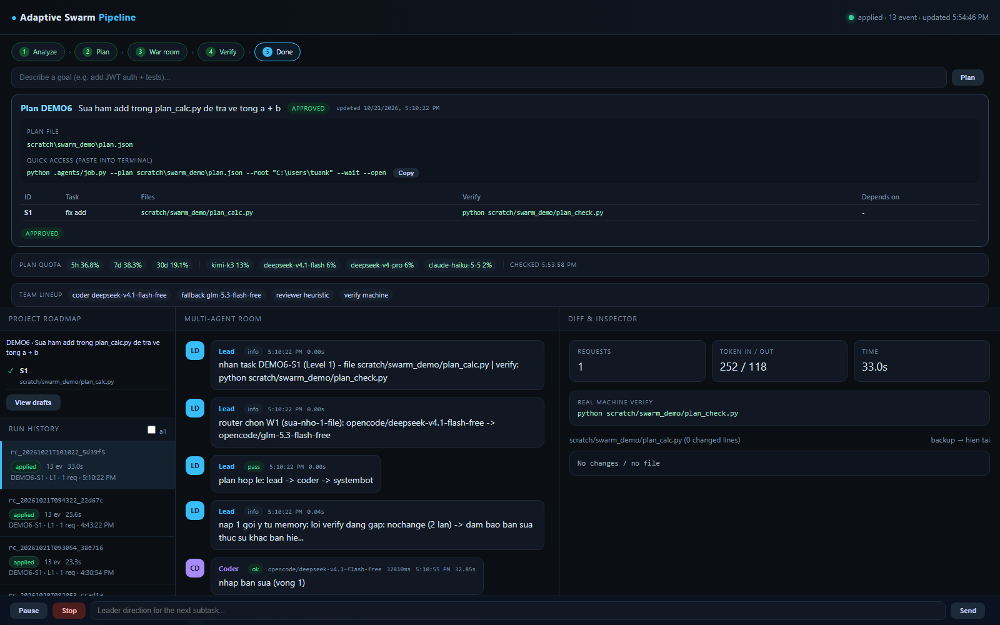
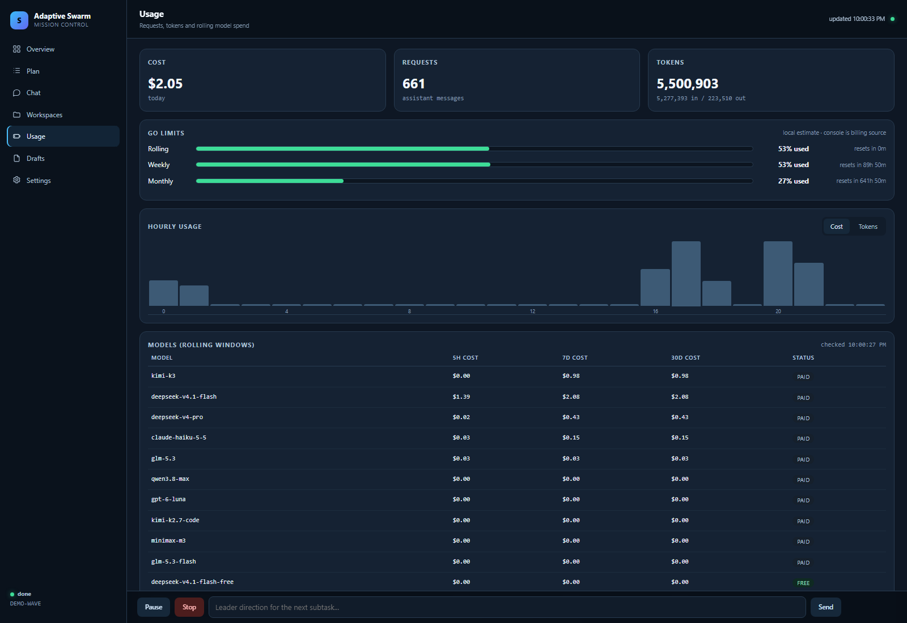
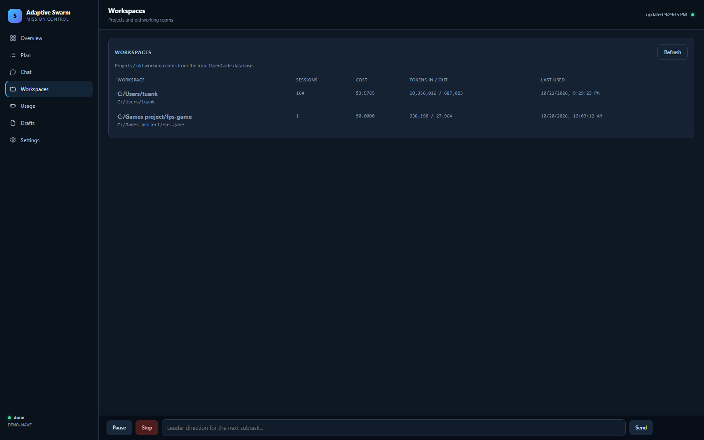
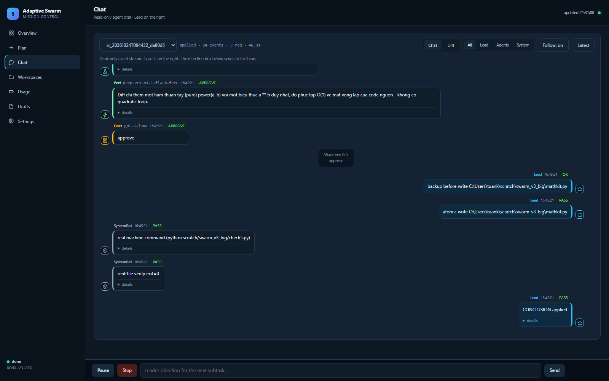

# Adaptive Swarm Pipeline



A **verification-first** coding harness for [OpenCode](https://opencode.ai):
several AI models work as one team, but nothing is written to your project unless a
real machine check passes.

> Status: **v1.0.9** (truthful coder model in job output).
> Original acceptance on Windows; Linux/macOS paths are supported and covered
> by the cross-platform CI workflow.
>
> Built with AI assistance; every change is machine-verified.

## Why

Most coding agents trust themselves. This one does not.

- **Verified apply** — a change is written only if `verify_command` exits `0`.
- **Atomic multi-file transaction** — Level 3 backs up every target first, writes all,
  verifies the whole project, then commits or rolls back *all* files to their exact bytes.
- **Crash recovery** — a journal in `.agents/tmp/tx/` lets the next run roll back an
  interrupted transaction.
- **Cross-family review** — the reviewer must come from a different model family than
  the coder, so it cannot rubber-stamp its own work.
- **Hard budget** - soft 8 / hard 16 requests / 600 seconds per run; fallback switches models inside
  the same call on 429/5xx/timeout.
- **Catalog-aware routing** �?" `scout` discovers local models; `router` selects from
  the local catalog and no longer assumes OpenCode Go is available.
- **Quota-aware routing** — reads real spend from `opencode stats`, tracks the shared
  plan budget *and* per-model caps, then picks main -> abundant escalate -> cheap/free.
- **Append-only ledger** — every event is evidence; replay, dashboard and memory read
  the same source.
- **Single writer** — only the Lead writes project files, always through `safe_writer`.

## Install (Windows / Linux / macOS)

Requirements: Python 3.11+ (3.12 recommended), Git, and the OpenCode CLI in `PATH`.

```bash
git clone https://github.com/khoacat12345/adaptive-swarm-pipeline.git
cd adaptive-swarm-pipeline
```

### Per machine

```bash
# Linux/macOS
python3 .agents/scout.py --write --verify   # free-only; pings main + 4 reviewers
python3 .agents/scout.py --write --allow-paid --verify  # paid opt-in

# Windows PowerShell
python .agents\scout.py --write --verify
python .agents\scout.py --write --allow-paid --verify
```

New installs are **free-only** by default. Paid models are never selected unless
you explicitly pass `--allow-paid`. This includes the `opencode-go/*`
subscription; `scout` reads `opencode auth list` so a stored Go credential is
not misreported as unconfigured. `config.json` stays machine-local and is not
committed.

### Per project

Copy the source `.agents/` and `.opencode/` folders into the project, then run
`scout --write` and the acceptance smoke test.

```bash
python3 .agents/tests/test_phase4.py --fast
```

Full cross-platform setup, optional skill discovery, dashboard and MCP notes:
**[docs/INSTALL.md](docs/INSTALL.md)**.

### First task

```bash
python3 .agents/recipe_c.py --order scratch/swarm_demo/order.json --route --json
```

Panel mode is the default. Meeting mode is opt-in:

```bash
python3 .agents/job.py --plan plan.json --mode meeting --reviewer wave --decision approve
```

`--mode meeting` requires `--reviewer wave`; it adds independent Round 1 plus at
most one targeted rebuttal and a machine re-verify before Lead applies.

### Health & cost preflight

Before a wave or meeting starts, the pipeline checks every required reviewer
model against the local catalog: provider availability, auth status, provider
health and cooldown. For meeting/wave it also cross-checks the **live**
`opencode models` catalog, so a model removed upstream cannot pass on an old
snapshot. Meeting/wave requires all four roles
(`security`, `qa`, `perf`, `docs`). If any role or route is unavailable, the run
**aborts before calling a model**; it never falls back to an automatic heuristic
approval. Health results are cached for 15 minutes and invalidated when
`config.json` or the model list changes. A cache older than 24 hours is
re-checked with a visible warning.

Preflight is also applied to the routed coder chain: a chain with at least one
available model proceeds; a chain with none is blocked. Meeting runs allow up to
600 seconds total; each role reviewer gets 240 seconds (override with
`SWARM_REVIEWER_TIMEOUT`). Use `python .agents/tests/test_preflight.py` to verify
the gate, or run `python .agents/preflight.py --live` manually. A live catalog
lookup failure makes meeting/wave fail closed.

## What a Work Order looks like

```json
{
  "task_id": "R1",
  "title": "fix add()",
  "objective": "Make add(a, b) return a + b",
  "boundaries": "Only edit calc.py",
  "input_context": "calc.py has add() returning a - b",
  "acceptance_criteria": "check.py exits 0 and add(2,3) == 5",
  "verify_command": "python check.py",
  "target_files": ["calc.py"],
  "sandbox_files": ["calc.py", "check.py"],
  "level": 1,
  "max_rounds": 1
}
```

Missing `verify_command` is rejected immediately. Level 1/2 take one target file;
Level 3 takes two or more and runs as one atomic transaction.

## Dashboard (mission control)

Open it with `dashboard.cmd` on Windows or `./dashboard.sh` on Linux/macOS, or
`job.py --wait --open` for full control with a token.

Left sidebar: **Overview, Plan, Chat, Workspaces, Usage, Drafts, Settings**.

- **Chat** is a chronological timeline (oldest first) with `HH:MM:SS` on every event;
  logs are not shown on the overview.
- **Workspaces** lists real OpenCode projects (old working rooms) with session count,
  cost and tokens.
- **Usage** shows exact per-request spend from `opencode.db` (today / 5h rolling /
  7d / 30d), per-model costs and a request log.
- Deep links: `/#overview`, `/#plan`, `/#chat`, `/#workspaces`, `/#quota`, `/#drafts`, `/#settings`.







## Goal -> plan (W4 planner)

```bash
python .agents/planner.py --goal "Add JWT auth and tests" --root . --submit
```

Or type the goal in the dashboard's input and click **Plan**: the planner reads the
project tree, proposes 1-5 subtasks with verification, validates that every target
exists and that dependencies are acyclic, then submits the plan for approval.

Planner uses the model chain from `.agents/config.json` (scout) and retries once
with validation errors if the first plan is invalid.

## Wave reviewers (parallel audit)

```bash
python .agents/job.py --plan plan.json --root . --reviewer wave --wait --open
```

Four read-only reviewers run **in parallel** (security, QA, perf, docs) and their
verdicts are aggregated: any reject blocks the apply. The default role models are
free/local; override with `SWARM_WAVE_ROLES` when you intentionally want paid models. The wave is **budget-aware**:
it uses the wave reservation/burst rules (soft 8 / hard 16). If fewer than four
roles can run, the wave **fails closed**: it returns reject/unavailable and never
auto-approves through the heuristic reviewer. `skipped` lists the roles that did
not run. Default remains the 0-request heuristic reviewer for panel mode.

Free dry-run (same free model for all four roles, $0):

```cmd
set SWARM_WAVE_ROLES=security=opencode/deepseek-v4.1-flash-free,qa=opencode/deepseek-v4.1-flash-free,perf=opencode/deepseek-v4.1-flash-free,docs=opencode/deepseek-v4.1-flash-free
python .agents/job.py --plan scratch/swarm_demo/plan_wave.json --root . --reviewer wave --model opencode/deepseek-v4.1-flash-free --decision approve
```

## Notifications (one-way)

Create `.agents/notify.json`:

```json
{"enabled": true, "kind": "discord", "url": "https://discord.com/api/webhooks/..."}
```

Kinds: `discord` (`content`), `telegram` (`chat_id` + `text`; `url` is the bot
`sendMessage` endpoint), `generic` (`text`). Events: `plan.submitted`,
`plan.approved`, `plan.rejected`, `job.done`. Notification failures never break a job.

### Telegram bot (two-way)

```json
{"telegram": {"bot_token": "123:ABC", "chat_id": 123456}}
```

```bash
python .agents/telegram_bot.py --root .
```

Only the configured `chat_id` is accepted. Commands: `/status`, `/approve`,
`/reject`, `/pause`, `/resume`, `/stop`, `/say <direction>`, `/help`.

## Tests

```bash
python .agents/tests/test_phase4.py       # observation layer
python .agents/tests/test_level3.py       # multi-file transaction + regressions
python .agents/tests/test_phase5.py        # router + fallback reviewer + regressions
python .agents/tests/test_quota.py         # quota math + quota-aware routing
python .agents/tests/test_phase6.py        # plan approval + job executor
python .agents/tests/test_planner.py       # goal -> plan + webhook notifications
python .agents/tests/test_wave.py          # 4 parallel reviewers + fail-closed budget
python .agents/tests/test_preflight.py     # health/cost preflight gate
python .agents/tests/test_skill_consistency.py # installed skill vs repo docs
python .agents/tests/test_telegram.py      # telegram bot commands/auth
python .agents/tests/test_protocol.py      # meeting protocol + blackboard
python .agents/tests/test_round1.py        # meeting round 1
python .agents/tests/test_rebuttal_policy.py
python .agents/tests/test_meeting_ui.py    # meeting transcript + graph contract
python .agents/tests/test_sse.py           # SSE stream/reconnect/token
python .agents/tests/test_adapter.py       # provider adapter + core AST gate
python .agents/tests/test_model_selector.py # local catalog routing/cost guard
python .agents/tests/smoke_suite.py        # engine + 10 real tasks
```

Hard model-selection tasks live in `.agents/tests/hard_tasks.py`; see
`.agents/tests/HARD_TESTS.md` for how to run them and their real cost.

## Layout

| Path | Purpose |
|---|---|
| `.agents/recipe_c.py` | pipeline engine (classify, verify twice, apply, rollback) |
| `.agents/safe_writer.py` | backup, atomic write, transaction, journal, rollback |
| `.agents/router.py` | work-type router (W0-W8) with cross-family chains |
| `.agents/quota.py` | real spend from `opencode stats` (shared + per-model caps) |
| `.agents/job.py` | plan approval, state/control, sequential executor |
| `.agents/planner.py` | goal -> plan.json (W4 planner) |
| `.agents/notify.py` | one-way Discord/Telegram/generic webhooks |
| `.agents/telegram_bot.py` | two-way Telegram control (/approve, /pause, /say) |
| `.agents/workers.py` | coders/reviewers (agentic CLI, scripted, fallback) |
| `.agents/sync_skill.py` | sync `.agents/SKILL.md` into the installed skill |
| `.agents/ledger.py`, `schema.py`, `replay.py`, `dashboard.py` | evidence + observability |
| `.agents/tests/` | acceptance suites and hard tasks |

Install guide: [`docs/INSTALL.md`](docs/INSTALL.md).

Full runbook: [`.agents/README.md`](.agents/README.md) (English); Vietnamese archive: [`README.vi.md`](.agents/README.vi.md)
and [`.agents/SKILL.md`](.agents/SKILL.md).

## Limitations (honest)

- Sequential execution; parallel independent workstreams/merge gate are roadmap (v1.5).
- Linux/macOS paths are supported; the original acceptance run was on Windows.
- No OS/container sandbox: verify commands run on the real machine.
- Verification is only as strong as your `verify_command`; a weak test gives false confidence.
- No repo-scale indexing/RAG; context is limited to the files you list in the order.
- Quota figures are read locally from `opencode stats`; the console remains the source of truth.

## Repository layout note

This repository was originally developed inside a home directory, so the root
`.gitignore` is a **whitelist**: it ignores everything and re-includes only
`.agents/`, `.opencode/`, `scratch/swarm_demo/` and `AGENTS.md`. The nested
`.agents/.gitignore` excludes runtime artifacts (ledger, backups, drafts, caches, secrets).

## License

MIT — see [LICENSE](LICENSE).
