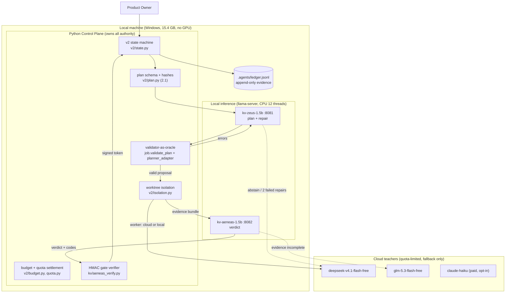
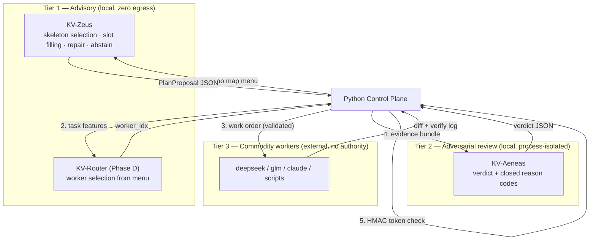
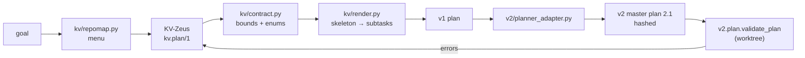
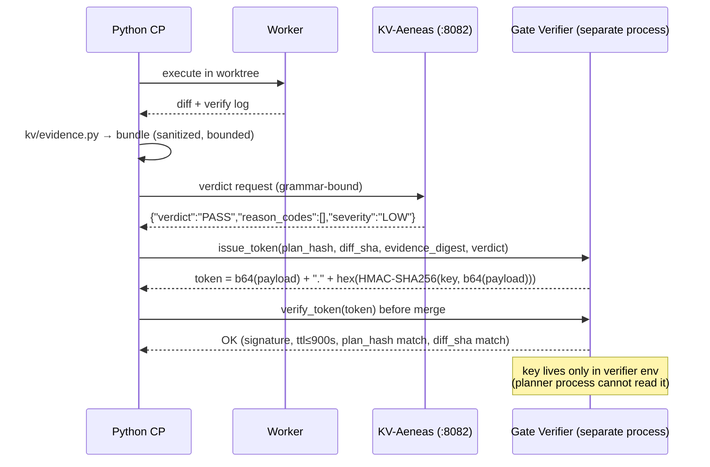
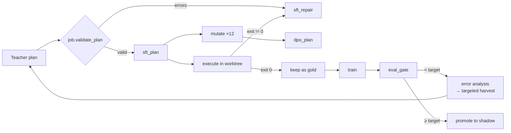

# KV-Series Sovereign Micro-Models — Production Implementation Plan

| Field | Value |
|---|---|
| **Document** | `docs/MODEL_PLAN.md` |
| **Version** | 1.0.0 |
| **Date** | 2026-11-13 |
| **Status** | Approved for execution (Phase A → D) |
| **Owner** | Product Owner (tuank) |
| **Executing roles** | Lead Orchestrator (Antigravity) · Code (DeepSeek) · Audit (GLM) |
| **Scope** | KV-Zeus (planner-lite + repair) · KV-Aeneas (zero-trust gate) · KV-Router |
| **Base model** | `Qwen/Qwen2.5-1.5B-Instruct` (Apache-2.0) |
| **Related** | `docs/SWARM_V2.1_SPEC.md`, `docs/CONSTITUTION.md`, `docs/UNIFIED_ENGINE_MASTERPLAN.md`, `.agents/README.md` |

---

## Table of Contents

1. [Executive Summary & Hardware Boundaries](#1-executive-summary--hardware-boundaries)
2. [Cognitive Architecture & Contracts](#2-cognitive-architecture--contracts)
3. [Data Strategy & Harvesting Pipeline](#3-data-strategy--harvesting-pipeline)
4. [4-Week Phased Milestones & Exit Criteria](#4-4-week-phased-milestones--exit-criteria)
5. [Risk Matrix & Circuit Breakers](#5-risk-matrix--circuit-breakers)
6. [Day-2 Runbook](#6-day-2-runbook)
7. [Definition of Done & Acceptance Checklist](#7-definition-of-done--acceptance-checklist)
8. [Decision Log (ADR)](#8-decision-log-adr)
9. [Glossary](#9-glossary)
10. [Appendix A — File Layout](#appendix-a--file-layout)
11. [Appendix B — Full GBNF Reference](#appendix-b--full-gbnf-reference)
12. [Appendix C — Metric Formulas](#appendix-c--metric-formulas)

---

# 1. Executive Summary & Hardware Boundaries

## 1.1 What we are building (and what we are not)

We are building a **sovereign advisory layer** for `adaptive-swarm-pipeline` and `waker-ai`: two or three small, locally-hosted adapters that turn *fuzzy* governance inputs into *schema-legal* proposals, and turn *structured evidence* into *auditable verdicts*.

| We ARE building | We are NOT building |
|---|---|
| A 1.5B planner that selects one of 8 plan skeletons and fills a **closed menu** of file/verify indices | A general-purpose "CEO" that reasons about arbitrary software architecture |
| A 1.5B inspector that emits `PASS`/`QUARANTINE` + closed-enum reason codes over structured evidence | A model with merge rights, git rights, or budget rights |
| A repair loop that consumes `validate_plan` errors and emits a corrected proposal | A model that self-escalates its own budget or retry count |
| A router that picks a worker from a 5–7 item menu | A model that writes code, prose, or documentation |

**Doctrine:** the *model* proposes; *Python* decides; the *validator* judges. There is no code path where a model output reaches `main` without an exit code `0` and a signed HMAC gate token.

## 1.2 Measured hardware profile

Measurements taken on the target machine on 2026-11-13:

| Component | Measurement | Consequence for this plan |
|---|---|---|
| CPU | AMD Ryzen 7 7730U, 8C / 16T (Zen 3, AVX2) | Good for quantized CPU inference; 12 threads for model, 4 reserved for pipeline |
| RAM | 15.4 GB total usable | Hard ceiling: **1× ≤3B Q4** or **2× ≤1.7B Q4** concurrently |
| GPU | AMD Radeon iGPU, 512 MB (no CUDA, no ROCm) | **Local training is physically impossible** |
| Storage | 575 GB free | Holds GGUF artefacts, datasets, Kaggle downloads |
| OS / Runtime | Windows 11, Python 3.12.10, Node v24.21.0 | `llama.cpp` prebuilt `win-avx2-x64` binaries |
| Local proxy precedent | `9router` at `127.0.0.1:20128/v1` already registered in `~/.config/opencode/opencode.json` | KV-series registers the same way at `127.0.0.1:8081/v1` |

## 1.3 RAM budget math (why 1.5B, not 3B)

Decode memory is dominated by weights + KV cache + graph buffers + server overhead:

```
RSS ≈ W(params, quant) + KV(ctx, layers, kv_heads, head_dim) + graph + server
KV per token = 2 (K,V) × layers × kv_heads × head_dim × 2 bytes (fp16)
```

| Model | Params | Layers | Q/KV heads | KV / token | Weights Q4_K_M | KV @ 4096 | Total RSS @ 4096 |
|---|---|---|---|---|---|---|---|
| `Qwen3-0.6B` | 0.6B | 28 | 16 / 8 | 112 KB | ~0.40 GB | 0.45 GB | **~1.1 GB** |
| `Qwen2.5-1.5B-Instruct` | 1.54B | 28 | 12 / 2 | 28 KB | ~0.99 GB | 0.12 GB | **~1.6 GB** |
| `Qwen2.5-3B-Instruct` | 3.09B | 36 | 16 / 2 | 36 KB | ~1.90 GB | 0.15 GB | **~2.5 GB** |

> Note the non-obvious result: **Qwen3-0.6B has a larger KV cache than Qwen2.5-1.5B** (8 KV heads vs 2). Parameter count alone is a bad proxy for RAM. The 1.5B model is the cheapest *capable* option on this machine.

**Concurrency plan (15.4 GB):**

| Scenario | Resident models | RAM | Verdict |
|---|---|---|---|
| Zeus + Aeneas | 2 × 1.5B Q4 | ~3.2 GB | ✅ Recommended (independence preserved) |
| Zeus + Aeneas + teacher fallback | 2 × 1.5B + cloud | ~3.2 GB + ~0.3 GB client | ✅ Normal production |
| Zeus + Aeneas + 3B draft | 1.5B + 1.5B + 3B | ~5.7 GB | ⚠️ Only for A/B week, then retire |
| 3 × 3B | 3 × 3B Q4 | ~7.5 GB | ❌ Leaves no headroom for verify subprocesses |
| 2 × 3B + Q8 upgrade | — | ~5.6 GB | ⚠️ Possible but slows inference 40% |

## 1.4 Inference throughput (estimates → must be measured in Week 0)

Decode on CPU is memory-bandwidth-bound: `tok/s ≈ effective_BW / bytes_read_per_token`. DDR4-3200 dual-channel peaks at 51.2 GB/s; a real 7730U workload sustains ~25–35 GB/s, and `llama.cpp` Q4 kernels achieve ~60–75% of that.

| Model | Quant | Est. decode | Est. prefill | Plan cycle (1.4k in / 350 out) | With prefix cache |
|---|---|---|---|---|---|
| 0.6B | Q4_K_M | 35–55 tok/s | 250–450 tok/s | ~8–12 s | ~6–9 s |
| **1.5B** | **Q4_K_M** | **18–28 tok/s** | **120–260 tok/s** | **~25–40 s** | **~18–30 s** |
| 1.5B | Q8_0 | 11–16 tok/s | 90–160 tok/s | ~35–55 s | ~26–40 s |
| 3B | Q4_K_M | 9–15 tok/s | 70–140 tok/s | ~50–75 s | ~40–60 s |

**These are estimates and are treated as untrusted until Week 0 produces real numbers.** The Week 0 exit gate requires a filled `kv/reports/w0_bench.json` from:

```bash
llama-bench.exe -m models/qwen2.5-1.5b-instruct-q4_k_m.gguf -t 12 -p 512,2048 -n 128,512 -r 3
```

Two engineering consequences, applied in Section 2.8:

1. **Prefill is the real cost, not decode.** Static blocks (system prompt, skeleton library, reason-code enum) go first and are reused via `--cache-reuse`, so only the variable block (goal + repo map) is re-prefilled.
2. **1.5B is the throughput sweet spot.** 3B costs ~2.5× the wall clock for a task where the bottleneck is guarantee engineering, not fluency.

## 1.5 Why local training is banned

| Factor | Local (7730U, iGPU) | Kaggle T4 ×2 |
|---|---|---|
| FP16/BF16 tensor cores | None (no CUDA, no ROCm) | 2 × 65 TFLOPS FP16 |
| Realistic QLoRA 1.5B throughput | ~30–60 samples/hour (CPU, if it fits at all) | ~1,500–3,000 samples/hour |
| 1 epoch on 3,000 samples | ~50–100 hours | **~35–55 minutes** |
| 4-bit nf4 kernels | Unsupported (`bitsandbytes` needs CUDA) | Native |
| Risk of OOM at seq 4096 | Very high on 15.4 GB | None (16 GB VRAM per T4, 4-bit 1.5B ≈ 1.4 GB) |
| Cost | Electricity + ~2 months of wall clock | **$0 (30 GPU-hours/week free tier)** |

**Rule (non-negotiable):** training runs on Kaggle, inference runs locally. The only artefacts that cross the boundary are (a) a LoRA adapter (~60 MB) or (b) a merged FP16 checkpoint (~3.1 GB for 1.5B), never the dataset in the other direction.

**Kaggle operating constraints to design around:**

- GPU quota: 30 h/week, counted while a GPU session is alive.
- Session max: ~12 h (GPU); we need 1–2 h per run, so quota is not the constraint — *iteration speed* is.
- T4 has no BF16: use `fp16=True` (Unsloth auto-detects); do not force `bf16`.
- Internet must be enabled for `pip install unsloth` and model download.
- `/kaggle/working` survives the session (~20 GB); everything else is wiped.
- Version every run: push datasets and adapters as **Kaggle Dataset versions** so runs are reproducible by reference, not by hope.

## 1.6 Deployment topology



## 1.7 Non-goals (explicit, to prevent scope drift)

1. **No Director/Decomposer micro-model.** Open-ended DAG decomposition from vague goals is out of reach for ≤3B. It stays with cloud teachers through 2027 Q1 at the earliest.
2. **No model-owned tools.** KV models get no filesystem, shell, or network tool access. They receive text and return JSON.
3. **No model-owned merge.** `git` operations remain exclusively in `v2/isolation.py` + `safe_writer`.
4. **No free-text reasoning requirement.** Chain-of-thought is not trained, not rewarded, and not parsed. If a model emits it, the grammar rejects it.
5. **No multi-turn chat.** Each call is single-turn with a versioned template. Conversation state is the Python caller's problem.
6. **No "sovereign base weights".** Sovereignty here means: local execution, zero egress, our adapter, our behaviour contract. Base weights remain Qwen/Apache-2.0.

---

# 2. Cognitive Architecture & Contracts

## 2.1 Two-tier sovereign hierarchy



### Authority matrix

| Capability | Python CP | KV-Zeus | KV-Aeneas | Worker |
|---|---|---|---|---|
| Read repo | ✅ | via Python-provided menu only | via Python-provided evidence only | ✅ (worktree) |
| Write repo | ✅ (`safe_writer`) | ❌ | ❌ | ✅ (worktree only) |
| Run verify | ✅ (`system_bot`) | ❌ | ❌ | ✅ (sandboxed) |
| Allocate budget | ✅ | ❌ | ❌ | ❌ |
| Decide merge | ✅ | ❌ | ✅ **negative only** | ❌ |
| Issue gate token | ✅ (verifier) | ❌ | ❌ (proposes only) | ❌ |
| Set own retry count | ❌ | ❌ | ❌ | ❌ |

> **Monotonic quarantine invariant (ADR-007):** KV-Aeneas may only *add* quarantine reasons. It can never remove a deterministic rule violation. This makes the model's failure mode "over-cautious", not "unsafe".

## 2.2 KV-Zeus contract — input

The input is deliberately **pre-digested**. The model never sees raw files; it sees a menu.

```json
{
  "schema": "kv.zeus.request/1",
  "task": "plan",
  "goal": "Them endpoint GET /health tra ve {\"ok\": true} va co test",
  "tier": "E2",
  "budget": { "max_subtasks": 5, "max_files_per_task": 3, "max_repair_loops": 2 },
  "skeletons": [
    "single_file_fix", "add_endpoint", "add_module", "refactor_module",
    "add_tests", "migrate_config", "perf_patch", "dep_upgrade"
  ],
  "repo_map": [
    { "idx": 0, "path": "src/api.py",    "sig": "def handle(req)->dict; def route(p)->None", "loc": 210, "has_tests": true },
    { "idx": 1, "path": "src/config.py", "sig": "load()->Config", "loc": 88,  "has_tests": false },
    { "idx": 2, "path": "tests/test_api.py", "sig": "test_route_ok(); test_bad_request()", "loc": 140, "has_tests": true }
  ],
  "verify_menu": [
    { "idx": 0, "cmd": "python -m pytest tests/test_api.py -q", "kind": "pytest" },
    { "idx": 1, "cmd": "python -m pytest -q", "kind": "pytest-full" },
    { "idx": 2, "cmd": "python -m compileall -q src", "kind": "compile" }
  ],
  "lessons": [
    "verify_command must be runnable on Windows without network",
    "do not target files containing secrets"
  ]
}
```

`repo_map` and `verify_menu` are produced by `kv/repomap.py`:

- **Files:** tree-sitter parse → top-30 by score `0.4×relevance(goal tokens) + 0.3×test_proximity + 0.2×recency + 0.1×size_penalty`.
- **Verify commands:** scan `pyproject.toml [tool.pytest]`, `package.json scripts`, `pytest.ini`, `Makefile`, and test file names → dedupe → run each through `system_bot.check_command()` → **drop anything blocked**. A command in the menu is therefore runnable *and* allowed by construction.

## 2.3 KV-Zeus contract — output

**Tier-1 (Week 2 target): classification + indices only. Zero free text.**

```json
{
  "schema": "kv.plan/1",
  "skeleton": "add_endpoint",
  "abstain": false,
  "primary_target_idx": 0,
  "support_target_idx": 2,
  "verify_idx": 0,
  "level": 2,
  "max_rounds": 2
}
```

**Tier-2 (Week 4+, only if Tier-1 metrics pass): two constrained free-text fields.**

```json
{
  "schema": "kv.plan/1",
  "skeleton": "add_endpoint",
  "abstain": false,
  "primary_target_idx": 0,
  "support_target_idx": 2,
  "verify_idx": 0,
  "level": 2,
  "max_rounds": 2,
  "objective": "add GET /health returning {ok:true}",
  "acceptance": "pytest tests/test_api.py exits 0 and /health returns 200"
}
```

Abstain form (the most important output the model can produce):

```json
{
  "schema": "kv.plan/1",
  "skeleton": null,
  "abstain": true,
  "abstain_code": "NO_SUITABLE_TARGET",
  "primary_target_idx": null,
  "support_target_idx": null,
  "verify_idx": null,
  "level": 1,
  "max_rounds": 1
}
```

`abstain_code` enum: `NO_SUITABLE_TARGET` · `AMBIGUOUS_GOAL` · `NEEDS_NEW_FILE` · `OUT_OF_SCOPE` · `INSUFFICIENT_CONTEXT`.

**Semantics that must hold in the renderer (`kv/render.py`):**

| Rule | Enforcement |
|---|---|
| `abstain=false` requires all indices non-null | renderer raises `ContractError` |
| `primary_target_idx` ∈ `[0, len(repo_map))` | renderer bounds-check |
| `verify_idx` ∈ `[0, len(verify_menu))` | renderer bounds-check |
| `level==3` requires both primary and support targets | renderer promotes or rejects |
| `level!=3` and both targets set | renderer keeps primary only, logs `ignored_support` |
| `skeleton==add_module` requires `allow_new_files=true` in the phase | renderer sets it, validator confirms |

Because indices replace path strings, **hallucinated file paths are structurally impossible** (`hallucination_rate` is measured anyway, as a canary).

## 2.4 KV-Aeneas contract — input

```json
{
  "schema": "kv.aeneas.request/1",
  "task": "verdict",
  "phase": "P1",
  "work_order": "W1",
  "level": 2,
  "rules": { "verdict": "GRAY", "codes": ["SCOPE_CREEP"] },
  "evidence": {
    "exit_code": 0,
    "timed_out": false,
    "diff_stat": { "files": 2, "added": 81, "removed": 4 },
    "files_changed": ["src/api.py", "tests/test_api.py"],
    "allowed_paths": ["src/api.py", "tests/test_api.py"],
    "forbidden_touched": [],
    "secret_scan": { "hits": 0, "kinds": [] },
    "verify_cmd": "python -m pytest tests/test_api.py -q",
    "verify_tail": "3 passed in 1.24s",
    "verify_attempts": 1,
    "new_imports": ["requests"],
    "declared_deps": ["pytest", "pyyaml"],
    "test_files_touched": ["tests/test_api.py"]
  }
}
```

Input is **bounded to ≤1,200 tokens** by a hard truncation in `kv/evidence.py`: `verify_tail` capped at 40 lines / 600 chars, `files_changed` capped at 30, no full diffs, no source code.

## 2.5 KV-Aeneas contract — output

```json
{
  "schema": "kv.verdict/1",
  "verdict": "QUARANTINE",
  "reason_codes": ["NEW_DEPENDENCY", "MISSING_TEST_EVIDENCE"],
  "severity": "MED"
}
```

Closed enum with deterministic triggers. **The model receives this table in its prompt and is scored only on codes that the rules cannot decide.**

| Code | Severity | Deterministic trigger (rules) | Model's job |
|---|---|---|---|
| `FORBIDDEN_PATH` | BLOCK | diff touches `.git/`, `.env`, `.agents/tmp`, `.agents/config.json` | — (rule-only) |
| `SECRET_LEAK` | BLOCK | `secret_scan.hits > 0` | — (rule-only) |
| `VERIFY_FAILED` | BLOCK | `exit_code != 0` | — (rule-only) |
| `VERIFY_TIMEOUT` | HIGH | `timed_out == true` | — (rule-only) |
| `TEST_TAMPER` | HIGH | `test_files_touched` ⊄ `allowed_paths` | — (rule-only) |
| `SCOPE_CREEP` | HIGH | `files_changed ⊄ allowed_paths` | — (rule-only) |
| `NEW_DEPENDENCY` | MED | import not in `declared_deps` ∪ stdlib | ✅ gray zone |
| `LARGE_DIFF` | MED | `added + removed > 400` | ✅ gray zone |
| `MISSING_TEST_EVIDENCE` | MED | `verify_tail` has no `passed`/`ok` marker | ✅ gray zone |
| `WEAK_ASSERTION` | LOW | tests file diff adds ≤1 assert | ✅ gray zone |
| `FLAKY_SIGNAL` | LOW | `verify_attempts ≥ 3` | ✅ gray zone |
| `UNKNOWN_EVIDENCE` | LOW | required field missing/`null` | ✅ gray zone |

**Gate algorithm (`kv/aeneas.py`):**

```python
def decide(rule_codes, model_codes, evidence) -> Verdict:
    if any(c in BLOCK_CODES for c in rule_codes):
        return Verdict("QUARANTINE", sorted(set(rule_codes)), "BLOCK")   # no model call
    codes = sorted(set(rule_codes) | set(model_codes))                    # monotonic union
    if any(c in HIGH_CODES for c in codes):
        return Verdict("QUARANTINE", codes, "HIGH")
    if len([c for c in codes if c in MED_CODES]) >= 2:
        return Verdict("QUARANTINE", codes, "MED")
    if not evidence_ok(evidence):
        return Verdict("QUARANTINE", codes + ["UNKNOWN_EVIDENCE"], "LOW")
    return Verdict("PASS", codes, "LOW")
```

Two properties fall out for free:

1. **Blocking violations never depend on the model** → a corrupted/misconfigured model cannot let a secret leak through.
2. **The model can only tighten** → its worst-case failure is a false quarantine (recoverable), never a false PASS (unrecoverable).

## 2.6 Schema mapping to the existing pipeline (critical)

There are **three** schemas in play. Confusing them is the single most common integration bug.

| Layer | Schema | Validator | Produced by |
|---|---|---|---|
| Model output | `kv.plan/1` (proposal fragment) | `kv/contract.py` | **KV-Zeus** |
| v1 job plan | `{job_id, objective, subtasks[]}` | `job.validate_plan()` + `system_bot.check_command()` | `kv/render.py` |
| v2 master plan | `schema_version: "2.1"`, `{run_id, goal, base_sha, budget, phases[]}` | `v2.plan.validate_plan(worktree=...)` | `v2.planning` via `v2/planner_adapter.py` |



**Non-negotiables copied from `v2/plan.py` 2.1** (the renderer must satisfy these on first try):

- Top level requires `run_id`, `goal`, `base_sha`, `budget`, `phases`.
- `MAX_PHASES = 6`, `MAX_WORK_ORDERS = 12`, `SCHEMA_VERSION = "2.1"`.
- Phase requires non-empty `allowed_paths`, non-empty `work_orders`, a `budget` object.
- Work order requires `objective`, `acceptance_criteria`, `verify_command`, `target_files`.
- `level ∈ {0,1,2,3}`; `level==3` needs ≥2 targets; `level!=3` accepts exactly 1.
- `max_rounds ∈ 1..4`.
- `verify_command` must pass `system_bot.check_command()` and must not be blocked.
- Paths must be relative, inside `allowed_paths`, outside `DEFAULT_FORBIDDEN`, and (unless `allow_new_files`) must already exist in the worktree.
- The dependency graph must be acyclic and reference only known phase ids.

Because the renderer reads these directly from `v2/plan.py` constants (not hardcoded copies), a future schema bump breaks loudly at import time rather than silently at merge time.

## 2.7 Grammar enforcement (GBNF)

Grammar gives us the one guarantee a small model can never give: **100% syntactically valid JSON at decode time**. It does not give semantic validity — that is the validator's job (ADR-004).

**Static grammar for verdict** (`kv/grammar/verdict.gbnf`, shipped as a file, loaded by `llama-server`):

```gbnf
root     ::= "{" ws "\"schema\"" ws ":" ws schema ws "," ws
             "\"verdict\"" ws ":" ws verdict ws "," ws
             "\"reason_codes\"" ws ":" ws codes ws "," ws
             "\"severity\"" ws ":" ws severity ws "}"

schema   ::= "\"kv.verdict/1\""
verdict  ::= "\"PASS\"" | "\"QUARANTINE\""
severity ::= "\"LOW\"" | "\"MED\"" | "\"HIGH\"" | "\"BLOCK\""
codes    ::= "[" ws (code (ws "," ws code)*)? ws "]"
code     ::= "\"SCOPE_CREEP\"" | "\"NEW_DEPENDENCY\"" | "\"LARGE_DIFF\""
           | "\"MISSING_TEST_EVIDENCE\"" | "\"WEAK_ASSERTION\""
           | "\"FLAKY_SIGNAL\"" | "\"UNKNOWN_EVIDENCE\""
           | "\"TEST_TAMPER\"" | "\"FORBIDDEN_PATH\"" | "\"SECRET_LEAK\""
           | "\"VERIFY_FAILED\"" | "\"VERIFY_TIMEOUT\""
ws       ::= [ \t\n]*
```

**Dynamic grammar for plans** (`kv/grammar/plan.gbnf.j2`): the enum of skeleton names and index bounds is injected per request from the menu, so the model *cannot* emit an out-of-range index or an unknown skeleton.

```gbnf
root     ::= "{" ws "\"schema\"" ws ":" ws pschema ws "," ws
             "\"skeleton\"" ws ":" ws skeleton ws "," ws
             "\"abstain\"" ws ":" ws boolean ws "," ws
             "\"primary_target_idx\"" ws ":" ws idx ws "," ws
             "\"support_target_idx\"" ws ":" ws idx ws "," ws
             "\"verify_idx\"" ws ":" ws vidx ws "," ws
             "\"level\"" ws ":" ws level ws "," ws
             "\"max_rounds\"" ws ":" ws rounds ws "}"

pschema  ::= "\"kv.plan/1\""
boolean  ::= "true" | "false"
skeleton ::= {{ skeleton_alternatives }}
idx      ::= {{ target_index_alternatives }} | "null"
vidx     ::= {{ verify_index_alternatives }} | "null"
level    ::= "1" | "2" | "3"
rounds   ::= "1" | "2" | "3" | "4"
ws       ::= [ \t\n]*
```

For a 30-file repo map this yields ~35 terminals; for a 200-file map, ~210 terminals (~1.5 KB of grammar). Do **not** build dynamic grammars beyond ~500 alternatives — use a tiered menu instead (Section 5.3).

**Request-time binding** (llama.cpp server accepts per-request grammar):

```python
payload = {
    "messages": [{"role": "system", "content": SYSTEM_PROMPT},
                 {"role": "user", "content": render_user(goal, repo_map, verify_menu)}],
    "temperature": 0.0,          # eval; 0.6 for best-of-N
    "top_p": 1.0,
    "max_tokens": 160,
    "grammar": grammar_text,     # generated from the menu
    "cache_prompt": True,        # reuse the static prefix
    "stop": ["</s>"],
}
```

Fallbacks if GBNF is unavailable (e.g. Ollama structured outputs): pass the equivalent JSON Schema via `response_format`; if the decoder still emits prose, `kv/parse.py` extracts the first balanced `{...}` and re-validates. Grammar is the fast path, not the only path.

## 2.8 Prompt assembly and token budget

Static prefix first (cache-reusable), variable block last:

| Block | Content | Tokens (target) | Cacheable |
|---|---|---|---|
| S1 System | role, invariants, "JSON only", abstain policy | 220 | ✅ |
| S2 Skeleton library | 8 skeletons × 1 line + slot rules | 180 | ✅ |
| S3 Contract reminder | field semantics, level rules | 90 | ✅ |
| V1 Goal | user goal (truncated 400 chars) | 60–110 | ❌ |
| V2 Repo map | ≤30 files × ~22 tokens | 480–660 | ❌ |
| V3 Verify menu | ≤8 commands | 60–100 | ❌ |
| V4 Lessons | ≤3 sanitized hints (`lesson_runtime._sanitize`) | 80 | ❌ |
| **Total** | | **~1,130–1,340** | |

Hard cap enforced in code: `MAX_PROMPT_TOKENS = 1600` (whitespace-tokenized estimate × 1.3). If exceeded, the repo map is trimmed by dropping the lowest-scored files — never by truncating mid-entry, which would corrupt the menu and desynchronize `idx` from the rendered plan.

`max_tokens = 160` for Tier-1. A 1.5B model that needs 400 output tokens for a 9-field JSON is not ready to be deployed, and the cap makes that failure visible immediately instead of hiding it in latency.

## 2.9 HMAC gate protocol



```python
# kv/gate.py  (verifier side; imported by the merge path only)
def issue(claims: dict, key: bytes) -> str:
    body = b64url(json.dumps(claims, sort_keys=True, separators=(",", ":")).encode())
    return f"{body}.{hmac.new(key, body.encode(), hashlib.sha256).hexdigest()}"

def verify(token: str, key: bytes, *, now: int) -> dict:
    body, sig = token.rsplit(".", 1)
    if not hmac.compare_digest(sig, hmac.new(key, body.encode(), hashlib.sha256).hexdigest()):
        raise GateError("BAD_SIGNATURE")
    claims = json.loads(b64url_decode(body))
    if now - claims["iat"] > claims.get("ttl", 900):
        raise GateError("EXPIRED")
    if claims["verdict"] != "PASS":
        raise GateError("NOT_PASS")
    return claims
```

Claims: `phase_id`, `plan_hash`, `diff_sha256`, `evidence_digest`, `verdict`, `reason_codes`, `iat`, `ttl`, `model`, `adapter_sha`.

**Threat model (stated honestly):**

| Threat | In scope? | Mitigation |
|---|---|---|
| Model output tries to fake `PASS` | ✅ | Verdict is rule-union; token issued by verifier process |
| Prompt injection from repo content | ✅ | Repo map is path+sig only; no file bodies; `lessons` sanitized |
| Replay of an old token on a new diff | ✅ | `diff_sha256` + `ttl` + `plan_hash` bound |
| Planner process reads the key | ✅ | Key in verifier env only; separate process, separate file ACL |
| Local admin attacker dumps process memory | ❌ | Out of scope; documented, not pretended away |

## 2.10 Contract versioning

- Every contract has an explicit `schema` string (`kv.plan/1`, `kv.verdict/1`).
- Adapters embed `adapter_sha256` in the gate claims → a gate token is traceable to exact weights.
- Bumping a contract requires: new grammar file, new dataset tag (`sft_plan.v2`), new eval baseline. Never mutate in place.
- **The model can be swapped without touching the control plane.** That is the test of whether the boundary was drawn correctly.

---

# 3. Data Strategy & Harvesting Pipeline

## 3.1 Asset inventory (measured on 2026-11-13)

| Asset | Path | Volume | Label quality | Use |
|---|---|---|---|---|
| Eval debug traces | `.agents/eval/phase2-free/debug/<provider>/T*/` | 40 cases × (prompt, output, file, feedback) over 4 models | **Gold** (real exit codes from `report.json`) | Eval seed + prompt-pattern mining |
| Phase-2 report | `.agents/eval/phase2-free/report.json` | 4 models × 10 tasks | Gold | Baseline comparison table |
| Ledger | `.agents/ledger.jsonl` | **8,056 events** / 1,831 runs | Silver (telemetry, no prompts) | Verify-command priors, failure corpus, event taxonomy |
| Ledger task events | same | `plan.validated` 92 · `recipe.coder` 87 · `system_bot.blocked` 300 · `safe_writer.verify` 169 | Silver | Blocked-command negatives, repair triggers |
| Hard tests | `.agents/tests/hard_tasks.py`, `HARD_TESTS.md` | task suite | Gold | Held-out evaluation |
| Smoke suite | `.agents/tests/smoke_suite.py` | suite | Gold | Regression gate |
| Plan validators | `.agents/v2/plan.py`, `.agents/job.py` | code | **Oracle** | Free labelling at scale |

**Conclusion:** we do not need to *buy* data. We need to *manufacture labelled pairs* using validators we already own. The oracle is the product.

## 3.2 Harvest algorithm (`kv/harvest.py`)

```
for source in [eval_debug, ledger_verifies, teacher_runs]:
    for record in source:
        goal        = extract_goal(record)          # skip if absent
        repo_map    = kv.repomap.build(record.root) # snapshot at that commit
        proposal    = kv.parse.extract_proposal(record.output)
        v1          = kv.render.render(proposal)    # may raise
        errors      = job.validate_plan(v1)
        if errors:                                   # still useful → repair corpus
            emit("sft_repair", proposal, errors, corrected=None)
            continue
        base_sha    = record.base_sha
        outcome     = record.exit_code
        if outcome == 0:
            emit("sft_plan", goal, menu, proposal)
            emit("dpo_plan", chosen=proposal, rejected=mutate(proposal))
        else:
            emit("sft_repair", proposal, outcome_errors, corrected=teacher_fix)
```

Dedup key: `sha256(skeleton | sorted(target_paths) | normalized_objective)[:16]`, keep max 3 near-duplicates per key. Contamination check: no `target_path` may appear in `eval/golden_200.jsonl`.

## 3.3 Synthetic rejection sampling (the free-data engine)

One valid proposal yields **12 broken variants, each with the exact validator error string**. This produces DPO pairs and repair SFT samples with zero model calls and zero teacher quota.

| # | Mutation | Resulting validator error (verbatim class) | Teaches |
|---|---|---|---|
| 1 | Delete `target_files` key | `subtask[i]: thieu target_files` | schema completion |
| 2 | Replace target with `src/ghost.py` | `target does not exist` | grounding |
| 3 | Prefix `../` | `path escapes project` | path safety |
| 4 | Target `.agents/config.json` | `target is forbidden` | forbidden awareness |
| 5 | `verify_command: "rm -rf /"` | `verify_command blocked` | command safety |
| 6 | `verify_command: "nonexistent.exe"` | `blocked: not allowed` | runnable commands |
| 7 | Duplicate subtask id | `id trung lap` | id discipline |
| 8 | `depends_on: [self]` | `depends_on bi vong lap` | DAG acyclicity |
| 9 | `depends_on: ["S9"]` (absent) | `depends_on ... khong ton tai` | referential integrity |
| 10 | 6 subtasks | `qua nhieu subtask (6 > 5)` | budget awareness |
| 11 | `level=3` with 1 target | `level 3 needs at least 2 targets` | level semantics |
| 12 | Remove `objective` | `thieu objective` | completeness |

Rules for mutation quality:

- Mutate **one field at a time** (attribution stays clean).
- Preserve JSON validity — a malformed-JSON negative teaches nothing once grammar is on.
- The DPO `rejected` must carry the *real* error text in its prompt; the model learns "error text → fix", which is exactly the repair skill.
- 20% of negatives are **hard negatives**: same skeleton, valid structure, but wrong target (a file that exists but cannot satisfy the goal). These are what separate a 60% model from an 85% model.

## 3.4 Dataset schemas

**`kv/datasets/sft_plan.jsonl`** (1,200 lines):

```json
{"messages":[
  {"role":"system","content":"<S1+S2+S3 frozen text, version kv.sys/1.0.0>"},
  {"role":"user","content":"<goal + menu, as rendered>"},
  {"role":"assistant","content":"{\"schema\":\"kv.plan/1\",\"skeleton\":\"add_endpoint\",\"abstain\":false,\"primary_target_idx\":0,\"support_target_idx\":2,\"verify_idx\":0,\"level\":2,\"max_rounds\":2}"}
 ],
 "meta":{"skeleton":"add_endpoint","source":"teacher:deepseek-v4.1-flash-free","label":"exit0","contract":"kv.plan/1","sys_version":"kv.sys/1.0.0"}}
```

**`kv/datasets/sft_repair.jsonl`** (900 lines) — user turn = proposal + validator errors:

```json
{"messages":[
  {"role":"system","content":"<system + 'fix the proposal; return JSON only'>"},
  {"role":"user","content":"PROPOSAL: {...}\nERRORS:\n- S1: target does not exist: src/ghost.py\n- S1: level 3 needs at least 2 targets"},
  {"role":"assistant","content":"{\"schema\":\"kv.plan/1\",\"skeleton\":\"single_file_fix\",...}"}],
 "meta":{"error_classes":["TARGET_MISSING","LEVEL_MISMATCH"],"round":1}}
```

**`kv/datasets/sft_aeneas.jsonl`** (700 lines):

```json
{"messages":[
  {"role":"system","content":"<aeneas system + reason code table>"},
  {"role":"user","content":"<evidence bundle JSON>"},
  {"role":"assistant","content":"{\"schema\":\"kv.verdict/1\",\"verdict\":\"QUARANTINE\",\"reason_codes\":[\"NEW_DEPENDENCY\"],\"severity\":\"MED\"}"}],
 "meta":{"expected_codes":["NEW_DEPENDENCY"],"class":"gray-zone","bucket":"quarantine-soft"}}
```

**`kv/datasets/dpo_plan.jsonl`** (1,500 pairs):

```json
{"prompt":[{"role":"system","content":"..."},{"role":"user","content":"..."}],
 "chosen":"{...valid plan...}",
 "rejected":"{...mutated plan + error context...}",
 "meta":{"mutation":"target_does_not_exist","error_class":"TARGET_MISSING"}}
```

## 3.5 Volume targets and allocation

| Dataset | Target | Phase A (repair) | Phase B (Aeneas) | Phase C (planner) | Phase D (router) |
|---|---|---|---|---|---|
| `sft_plan.jsonl` | **3,000** | 1,200 | — | 1,700 | 100 |
| `sft_repair.jsonl` | (inside 3,000) | **900** | — | 300 | — |
| `sft_aeneas.jsonl` | (inside 3,000) | — | **700** | — | — |
| `sft_router.jsonl` | (inside 3,000) | — | — | — | 200 |
| `dpo_plan.jsonl` | **1,500** | 500 | — | 900 | 100 |

> Counts are partitioned, not stacked: the 3,000 SFT budget covers all roles, weighted by the phased priority. If Week 2 shows repair saturating early, the budget shifts to planner samples without changing the total.

Bucket balance constraints (enforced by `kv/dataset.py --check`):

- Each of the 8 skeletons: 8–20% of `sft_plan` (no skeleton may dominate).
- `abstain:true` samples: **10–15%** of `sft_plan`. Under-representation here is the #1 cause of a model that confidently picks a wrong file.
- Aeneas: 45% PASS · 35% quarantine-soft (gray) · 20% quarantine-hard (rule) — the hard bucket exists only so the model learns to agree with rules, not to replace them.
- Vietnamese goals: 40–50% (the real distribution of user goals), English 50–60%. Never translate code identifiers.

## 3.6 Splits and leakage control

| Split | Share | Composition |
|---|---|---|
| Train | 70% | All sources |
| Val | 15% | Same repos, unseen goals |
| Test (in-distribution) | 10% | Same repos, held-out goals |
| **Test (held-out repo)** | **5%** | A repo never seen in training (a small external project with pytest + pyproject) |

Group split by `repo_id`, never by row — otherwise near-duplicate file menus leak the answer. The held-out repo is the only honest measure of generalization and is reported separately in every eval table.

## 3.7 Quality gates (`kv/dataset.py --check`, must exit 0 before any training run)

| Gate | Rule | Action on failure |
|---|---|---|
| Schema validity | 100% of assistant messages parse and pass `kv/contract.py` | drop row |
| Chosen-plan validity | 100% pass `job.validate_plan` | drop row |
| Rejected-plan validity | 100% fail validator with the recorded error class | regenerate row |
| Index bounds | every `*_idx` within its menu | drop row |
| Secret scan | `secret_scan.py` hits == 0 | redact or drop |
| Path hygiene | no `C:\Users\...`, no email, no absolute path | replace with `[root]` |
| Dedup | ≤3 near-duplicates per dedup key | drop excess |
| Contamination | no target path present in `golden_200` | drop row |
| Length | assistant ≤160 tokens, prompt ≤1,600 tokens | drop row |

## 3.8 The flywheel



The loop's fuel is `job.validate_plan` + exit codes. Both already exist. That is why this plan is 4 weeks and not 6 months.

---

# 4. 4-Week Phased Milestones & Exit Criteria

## 4.0 Overview

| Week | Phase | Primary deliverable | Hard exit gate |
|---|---|---|---|
| 0 | Baseline | `kv/eval_gate.py` + `golden_200.jsonl` + measured bench | Baseline table filled with **measured** tok/s and pass rates |
| 1 | Data | `sft_plan` / `sft_repair` / `dpo_plan` built and gated | `kv/dataset.py --check` exits 0; counts hit targets |
| 2 | Train v1 | `kv-zeus-1.5b` Q4_K_M GGUF (plan + repair) | Beats raw baseline by ≥15 pts pass@1 |
| 3 | Integrate | Provider wired + HMAC gate + 2-day shadow | ≥200 shadow samples, 0 KV-caused incidents |
| 4 | DPO + decide | DPO adapter + promote/demote ADR | Decision recorded against kill criteria |

Nothing in Week 2 starts until Week 1's gate is green. A model trained on ungated data is a week of compute burned for a number you cannot trust.

## 4.1 Week 0 — Pre-training baseline and tooling

### Tasks

| # | Task | Artifact | Command / detail |
|---|---|---|---|
| 0.1 | Install `llama.cpp` (AVX2 CPU build) | `C:\tools\llama.cpp\` | Download `llama-bXXXX-bin-win-avx2-x64.zip`; verify `llama-server.exe --version` |
| 0.2 | Create dirs | `kv/{grammar,datasets,models,reports,adapters}` | — |
| 0.3 | Freeze schema 2.1 | `kv/contract.py`, `kv/schemas/*.json` | Import constants from `v2.plan`; do not copy-paste numbers |
| 0.4 | Golden set | `kv/eval/golden_200.jsonl` | 60 mined from `eval/phase2-free/debug` + 100 hand-written + 40 cross-repo |
| 0.5 | `kv/eval_gate.py` | working harness | Metrics in Appendix C; `--report` writes JSON |
| 0.6 | `kv/repomap.py` | tree-sitter menu builder | Files + verify menu; `system_bot.check_command()` filter |
| 0.7 | `kv/render.py` + `kv/contract.py` | proposal → v1 plan → v2 plan | Unit tests vs `job.validate_plan` |
| 0.8 | Grammars | `plan.gbnf.j2`, `verdict.gbnf` | Verify with `llama-gbnf-validator` if available |
| 0.9 | Zero-shot baseline | `kv/reports/w0_baseline.json` | 3 models × 200 items × temp 0 + grammar |

### Baseline matrix (fill with measured values)

| Model | Quant | Decode tok/s | Prefill tok/s | JSON valid | pass@1 | pass@2 | Latency p95 | Note |
|---|---|---|---|---|---|---|---|---|
| `Qwen2.5-1.5B-Instruct` | Q4_K_M | _tbd_ | _tbd_ | _tbd_ | _tbd_ | _tbd_ | _tbd_ | primary baseline |
| `Qwen3-0.6B` | Q4_K_M | _tbd_ | _tbd_ | _tbd_ | _tbd_ | _tbd_ | _tbd_ | router candidate |
| `Qwen2.5-3B-Instruct` | Q4_K_M | _tbd_ | _tbd_ | _tbd_ | _tbd_ | _tbd_ | _tbd_ | ceiling check |

### Commands

```powershell
# 0.1 — install (no CUDA)
Invoke-WebRequest -Uri $LLAMA_ZIP -OutFile llama.zip
Expand-Archive llama.zip -DestinationPath C:\tools\llama.cpp

# 0.9 — serve raw base model for baseline
C:\tools\llama.cpp\llama-server.exe `
  -m kv\models\qwen2.5-1.5b-instruct-q4_k_m.gguf `
  --host 127.0.0.1 --port 8081 -t 12 -c 4096 -np 1 `
  --cache-reuse 256 --jinja

# 0.9 — run gate
python kv\eval_gate.py --model qwen2.5-1.5b-instruct-q4_k_m `
  --golden kv\eval\golden_200.jsonl --temp 0 --grammar kv\grammar\plan.gbnf.j2 `
  --report kv\reports\w0_baseline.json

# throughput truth
C:\tools\llama.cpp\llama-bench.exe -m kv\models\qwen2.5-1.5b-instruct-q4_k_m.gguf -t 12 -p 512,2048 -n 128,512 -r 3
```

### Exit criteria (all must hold)

1. `kv/reports/w0_baseline.json` exists with **measured** (not estimated) tok/s for 3 models.
2. Golden set = 200 items, 40 of which are cross-repo, and every item has a machine-checkable expectation.
3. Grammar-bound decode produces syntactically valid JSON on **200/200** baseline calls.
4. Decode throughput measured ≥ 15 tok/s for 1.5B Q4_K_M (if lower, stop and fix threading/`-t` before training).
5. `kv/render.py` → `v2.plan.validate_plan` round-trip passes on 20 hand-written proposals.

> **Decision point:** if raw `Qwen2.5-1.5B-Instruct` + grammar already reaches **≥65% pass@1**, the plan shifts to "grammar + prompt engineering first, training only for repair". This is a real possibility and worth 3 days to find out before spending 30 GPU-hours.

## 4.2 Week 1 — Data flywheel and harvesting

| # | Task | Artifact | Exit signal |
|---|---|---|---|
| 1.1 | `kv/harvest.py` (eval debug + ledger) | module + tests | 60+ records parsed, 0 unhandled schema |
| 1.2 | `kv/synth.py` (12 mutators) | module + tests | each mutator produces the expected error class |
| 1.3 | Teacher distillation batch 1 | `raw/teacher_*.jsonl` | ≥400 accepted proposals |
| 1.4 | `kv/dataset.py --check` | gate script | exits 0 |
| 1.5 | Build splits | `train/val/test/cross` | group split by repo |
| 1.6 | Aeneas evidence synthesizer | `sft_aeneas.jsonl` | 700 rows, 3 buckets balanced |

### Volume checkpoint

| Dataset | Week 1 target | Stretch |
|---|---|---|
| `sft_plan.jsonl` | 1,200 | 1,700 |
| `sft_repair.jsonl` | 900 | 1,200 |
| `dpo_plan.jsonl` | 1,500 (mutation-only) | 1,500 |
| `sft_aeneas.jsonl` | 700 | 700 |

Mutation-only DPO means Week 1 needs **no teacher quota for preferences at all** — 1,200 valid proposals × 1 mutation each = 1,200 pairs, plus 300 hard negatives from real `system_bot.blocked` events in the ledger.

### Exit criteria

1. `python kv/dataset.py --check --dir kv/datasets` exits `0`.
2. 100% of `chosen` plans pass `job.validate_plan`; 100% of `rejected` fail with the recorded class.
3. `abstain` share ∈ [10%, 15%]; no skeleton >20% or <8%.
4. Cross-repo test split sealed and hashed (hash committed in `kv/datasets/SPLITS.sha256`).
5. Sanitization proven: `grep -R "C:\\\\Users" kv/datasets` returns nothing.

## 4.3 Week 2 — Kaggle training loop 1 (Plan Repair + Aeneas)

Priority order from the Product Owner: **Phase A (repair) → Phase B (Aeneas) → Phase C (planner)**. Weeks 2 trains A+B in one multi-task adapter plus one specialist.

### Kaggle notebook outline (`notebooks/kv_train_v1.ipynb`, committed as source)

```python
# Cell 1 — environment (T4, internet ON)
!pip install -q unsloth trl peft accelerate bitsandbytes datasets
import torch; assert torch.cuda.is_available(), "GPU must be enabled"

# Cell 2 — model
from unsloth import FastLanguageModel
model, tok = FastLanguageModel.from_pretrained(
    model_name="Qwen/Qwen2.5-1.5B-Instruct",
    max_seq_length=4096, load_in_4bit=True, dtype=None,   # T4 → fp16 auto
)
model = FastLanguageModel.get_peft_model(
    model, r=16, lora_alpha=32, lora_dropout=0.0, bias="none",
    target_modules=["q_proj","k_proj","v_proj","o_proj",
                    "gate_proj","up_proj","down_proj"],
    use_gradient_checkpointing="unsloth", random_state=3407,
)

# Cell 3 — data (upload datasets as a private Kaggle Dataset)
from datasets import load_dataset
ds = load_dataset("json", data_files={
    "train": "/kaggle/input/kv-sft-v1/train.jsonl",
    "val":   "/kaggle/input/kv-sft-v1/val.jsonl",
})

# Cell 4 — train
from trl import SFTTrainer, SFTConfig
args = SFTConfig(
    output_dir="/kaggle/working/out",
    per_device_train_batch_size=4, gradient_accumulation_steps=4,   # eff 16
    num_train_epochs=2, learning_rate=1e-4, lr_scheduler_type="cosine",
    warmup_ratio=0.05, weight_decay=0.01, optim="adamw_8bit",
    max_seq_length=4096, packing=False,                              # keep JSON boundaries
    logging_steps=10, eval_strategy="steps", eval_steps=50,
    save_strategy="epoch", seed=3407,
)
SFTTrainer(model=model, tokenizer=tok, train_dataset=ds["train"],
           eval_dataset=ds["val"], args=args).train()

# Cell 5 — save adapter only (~60 MB, fast upload)
model.save_pretrained("/kaggle/working/adapter"); tok.save_pretrained("/kaggle/working/adapter")
```

**Why `packing=False`:** packing concatenates samples and blurs the JSON boundary, teaching the model to continue a previous document. Structure is the product here.

### Local merge + quantize (recommended: transfer 60 MB, merge on CPU)

```powershell
# adapter-only download from Kaggle output → kv\adapters\v1\
python -m venv .venv-gguf
.\.venv-gguf\Scripts\pip install -r C:\tools\llama.cpp\requirements\requirements-convert_hf_to_gguf.txt torch --index-url https://download.pytorch.org/whl/cpu

python C:\tools\llama.cpp\convert_hf_to_gguf.py kv\models\merged-v1 `
  --outfile kv\models\kv-zeus-1.5b-f16.gguf --outtype f16

C:\tools\llama.cpp\llama-quantize.exe kv\models\kv-zeus-1.5b-f16.gguf `
  kv\models\kv-zeus-1.5b-Q4_K_M.gguf Q4_K_M
```

Merge peak RAM for 1.5B FP16 ≈ 3.1 GB weights + ~3.5 GB transient → ~7 GB, safe on 15.4 GB. For a 3B experiment, merge **on Kaggle** (FP16 6.2 GB) and download the GGUF instead; local merge would cross the 12 GB danger line.

### Training economics

| Run | Samples | Seq | Effective batch | Steps/epoch | Wall clock (T4) |
|---|---|---|---|---|---|
| Zeus/repair multi-task | 2,100 | 4096 | 16 | 131 | ~40–70 min |
| Aeneas specialist | 700 | 2048 | 16 | 44 | ~10–20 min |
| DPO | 1,500 pairs | 2048 | 8 | 188 | ~60–90 min |

At 30 GPU-hours/week, Week 2-4 combined use **~6–9 hours**. The binding constraint is human iteration time, not quota — which is exactly why Week 0 and Week 1 are measurement-heavy.

### Adapter policy (ADR-003)

| Adapter | Tasks | Why separate |
|---|---|---|
| `kv-zeus-1.5b` | `plan`, `repair` | Shares the menu vocabulary; low latency is critical |
| `kv-aeneas-1.5b` | `verdict` | Independence from the planner; different prompt, different failure mode |

Two Q4 models ≈ 3.2 GB resident — comfortably inside 15.4 GB. Do **not** merge them into one multi-task adapter: Aeneas's value is that it does not share weights, prompt, or biases with the thing it inspects. That is a governance property, not an optimization knob.

### Exit criteria

1. `kv-zeus-1.5b-Q4_K_M.gguf` runs locally at ≥15 tok/s and passes a 20-item smoke.
2. pass@1 beats raw baseline by **≥15 points**; pass@2 ≥ 92%.
3. Repair: ≥80% of broken proposals fixed within 2 rounds.
4. Aeneas: quarantine precision ≥0.90, false-quarantine ≤5%, **recall on gold violations = 1.00** (rules guarantee this; the model must not degrade it).
5. `adapter_sha256` recorded in `kv/reports/w2_train.json`.

## 4.4 Week 3 — Shadow mode and HMAC integration

### 3a. Register the local provider (following the `9router` precedent)

`~/.config/opencode/opencode.json` — add to `provider`:

```json
{
  "kv-local": {
    "options": { "baseURL": "http://127.0.0.1:8081/v1", "apiKey": "local-kv-no-auth" },
    "models": {
      "kv-zeus-1.5b":   { "name": "KV-Zeus 1.5B (local)",   "limit": { "context": 4096, "output": 512 } },
      "kv-aeneas-1.5b": { "name": "KV-Aeneas 1.5B (local)", "limit": { "context": 4096, "output": 256 } }
    }
  }
}
```

`apiKey` must be present (any non-empty value) because `scout.py:read_opencode_configs` marks a provider `available` only when `options.apiKey` exists.

### 3b. One-line probe patch (required, not optional)

`scout.py` only TCP-probes providers in the hardcoded `LOCAL_PROXY_PROVIDERS` map. Without this patch, a dead `llama-server` stays marked `available` and every call fails at runtime instead of being excluded at selection time — violating the existing invariant *"a local proxy that is down must never be selected as a role model."*

```python
# .agents/scout.py
LOCAL_PROXY_PROVIDERS = {
    "9router": ("127.0.0.1", 20128),
    "kv-local": ("127.0.0.1", 8081),   # add
}
```

### 3c. Role wiring with cloud fallback

```json
{
  "roles": {
    "kv_planner": {
      "chain": ["kv-local/kv-zeus-1.5b",
                "opencode/deepseek-v4.1-flash-free",
                "opencode/glm-5.3-flash-free"],
      "primary": "kv-local/kv-zeus-1.5b",
      "fallbacks": ["opencode/deepseek-v4.1-flash-free", "opencode/glm-5.3-flash-free"],
      "primary_provider": "kv-local",
      "primary_family": "qwen",
      "primary_cost_tier": "free",
      "why": "local, zero egress, no quota; cloud fallback on abstain or 2 failed repairs"
    }
  }
}
```

**Config-write rule:** `config.json` is generated by `scout.py`. Do not hand-edit it. Either (a) add `kv-local` to the scout catalog path, or (b) maintain `kv/config.overlay.json` and merge it in `scout.py --write` with an explicit `--overlay` flag. Hand-editing is guaranteed to be lost on the next scout run.

### 3d. HMAC integration

- `kv/gate.py` (verifier) — key from env `KV_GATE_KEY` (32 bytes, hex), never from a file the planner reads.
- Merge path in `v2/runner.py` calls `gate.verify()` before any apply. Missing/invalid token → `QUARANTINED` with `reason_code = GATE_TOKEN_MISSING`.
- Ledger event `kv.gate` with `{phase, verdict, codes, token_issued, model, adapter_sha}`.

### 3e. Two-day shadow run

```
SWARM_KV_SHADOW=1 python .agents/v2/swarm_cli.py --goal "..." --tier E2
```

Shadow semantics: KV proposes, teacher decides, **KV never influences the outcome**. Every disagreement is logged as `kv.shadow.diff` with both proposals. This produces the most valuable dataset we cannot synthesize: *real* decision boundaries.

### Exit criteria

1. `llama-server` down → role chain falls back within 2 s, job completes, ledger shows `kv.unavailable` (proves the probe patch works).
2. ≥200 shadow samples; agreement rate ≥70%; every diff categorised into one of 8 skeleton buckets.
3. **0 incidents** where a KV output reached a merge that the teacher would have rejected.
4. HMAC: forged token, expired token, reused token on a new diff → all three rejected with distinct error codes (negative tests committed).
5. `test_adapter.py`, `test_phase*.py`, `test_v2_*.py` remain green.

## 4.5 Week 4 — DPO tuning and kill/promote gate

| # | Task | Detail |
|---|---|---|
| 4.1 | DPO run | Unsloth `DPOTrainer`, β=0.1, lr 5e-5, 1 epoch, 1,500 pairs |
| 4.2 | Re-quantize | Q4_K_M, verify tok/s unchanged |
| 4.3 | A/B matrix | baseline raw · SFT · SFT+DPO · teacher (4 columns × same 200 items) |
| 4.4 | Error analysis | top-10 failure clusters, each with a concrete mitigation or accepted risk |
| 4.5 | Decision ADR | promote / partial / demote, with numbers |
| 4.6 | Archive | datasets versioned, adapters + reports + `SPLITS.sha256` |

### Decision matrix

| Condition (after 2 training rounds) | Decision | Action |
|---|---|---|
| 1.5B pass@1 ≥ 75% and repair ≥ 85% and latency p95 ≤ 45 s | **PROMOTE** | KV-Zeus becomes primary planner at `E1/E2`; teacher for `E3/E4` |
| pass@1 60–75% | **PARTIAL** | KV handles repair + Aeneas + router only; planner stays teacher |
| pass@1 < 60% | **DEMOTE** | Planner permanently teacher; KV ships as repair/Aeneas specialist |
| Aeneas recall < 0.85 or false-quarantine > 5% | **DEMOTE Aeneas** | Advisory logging only, rules decide |
| Hang rate > 1% or p95 > 90 s | **BLOCK** | Do not integrate until fixed; investigate threading/context |

**Kill criteria are pre-committed.** A kill is a success: you learn in 4 weeks and for $0 that a 1.5B planner is not viable on this hardware, instead of discovering it after 3 months of integration work.

## 4.6 Rollback per week

| Week | Rollback | Blast radius |
|---|---|---|
| 0 | Delete `kv/` dirs | none (no integration) |
| 1 | Delete datasets, keep scripts | none |
| 2 | Keep adapter, revert `config.json` overlay | none (not wired) |
| 3 | `SWARM_KV_SHADOW=0`; revert `LOCAL_PROXY_PROVIDERS` + role chain | one commit revert |
| 4 | Revert DPO adapter, keep SFT adapter | one model swap |

No week requires a database migration, a schema change to `v2.plan`, or a change to the ledger format. That is deliberate: the KV series is additive.

---

# 5. Risk Matrix & Circuit Breakers

## 5.1 Risk register

| ID | Risk | Prob. | Impact | Detection | Mitigation |
|---|---|---|---|---|---|
| R1 | 1.5B can't reach pass@1 ≥ 60% | **High** | High | Week 2 gate | Pre-committed demote path; repair+Aeneas still deliver value |
| R2 | Context saturation on large repos | High | Med | `prompt_tokens > 1600` counter | Tiered menu (5.3), tree-sitter scoring, drop lowest-ranked entries |
| R3 | Local server hang stalls the pipeline | Med | High | `/health` probe + wall clock | 60 s hard timeout, 2 failures → open breaker, cloud fallback |
| R4 | False quarantine blocks legit work | Med | Med | Shadow agreement + false-quarantine rate | Mandatory `reason_codes`; ≤5% budget; human override with audit event |
| R5 | Personal path/secret leakage into training data | Med | **High** | `secret_scan` + regex gate | `lesson_runtime._sanitize` + path normalization, gate must exit 0 |
| R6 | Overfit to this repo, fails elsewhere | High | Med | Cross-repo split | 40 cross-repo golden items; report separately |
| R7 | Grammar/decoder overhead hurts latency | Med | Low | Bench in Week 0 | Grammar compile cached; static grammar for verdict |
| R8 | `scout.py` regeneration wipes local roles | **High** | Med | Role missing after scout run | Overlay mechanism (3c), CI check that `kv_planner` role exists |
| R9 | Two adapters drift (Zeus/Aeneas disagree on contract) | Med | Med | Contract version test | Single `kv/contract.py`, versioned `kv.sys/*`, import-time assertion |
| R10 | Teacher data is wrong (silent bad plan) | Med | Med | Executed-labelled subset | Only exit-code-labelled data enters the gold bucket |
| R11 | DPO degenerates (mode collapse, empty output) | Low | Med | Val loss + output-length histogram | β sweep {0.05, 0.1, 0.2}; reject run if mean length drops >40% |
| R12 | Windows path/encoding bugs (`charmap`) | Med | Low | Unit tests with Vietnamese goals | `encoding="utf-8"` everywhere; tests with diacritics |

## 5.2 Circuit breaker specification

All breakers are implemented in Python, never in the model. Each fires a ledger event.

| Breaker | Trigger | Action | Reset | Event |
|---|---|---|---|---|
| `CB_TIMEOUT` | single call > 60 s | abort call, fallback to next in chain | next call | `kv.timeout` |
| `CB_HANG` | 2 consecutive timeouts | open breaker 10 min; route role to teacher | 10 min TTL | `kv.breaker.open` |
| `CB_HEALTH` | `/health` fails 3× in 30 s | mark provider `unavailable` (probe patch) | next probe OK | `kv.provider.down` |
| `CB_SCHEMA` | contract violation (out-of-range idx, null required) | drop output, count 1 violation | 5 min | `kv.contract.violation` |
| `CB_REPAIR_LOOP` | 2 failed repair rounds | escalate to teacher, keep original proposal | per task | `kv.repair.escalate` |
| `CB_QUARANTINE_BUDGET` | false-quarantine rate > 5% over 50 phases | Aeneas → advisory-only | manual | `kv.aeneas.demoted` |
| `CB_PROMPT_SIZE` | prompt > 1,600 tokens | trim repo map, log `trimmed_files` | per call | `kv.prompt.trimmed` |
| `CB_CONFIDENCE_GAMING` | abstain rate > 40% over 100 calls | alert + error analysis (model is dodging) | manual | `kv.abstain.spike` |

**Rule:** any breaker that can be triggered by a *model output* must be evaluated in Python. A model must never be able to reset its own breaker.

## 5.3 Context saturation (the physical limit)

Empirical pattern for 1.5B-class models: accuracy degrades sharply once the prompt exceeds ~40% of the trained context, and instruction-following collapses around 6–8 KB of dense structured input.

| Repo size | Files in map | Tokens | Strategy |
|---|---|---|---|
| ≤ 50 | top 30 | ~1,100 | Single-pass (default) |
| 50–300 | top 20 + "more files exist" note | ~1,300 | Raise scoring threshold; require `has_tests` bonus |
| 300–2,000 | top 12, two-stage | ~1,400 | Stage 1: model picks a *folder* from ≤12 dirs. Stage 2: re-query with that folder's top 12 files |
| > 2,000 | top 8 + explicit `abstain` bias | ~1,300 | Prefer abstain → teacher. Do not pretend |

Two implementation rules that prevent silent corruption:

1. The menu is **atomic**: never truncate a `{idx, path, sig}` entry. Drop whole entries.
2. `idx` values are **compacted after trimming** so the model always sees `0..N-1`. A gap in indices is a bug that produces confidently wrong targets.

## 5.4 Hang and watchdog

```python
# kv/client.py
with ThreadPoolExecutor(max_workers=1) as pool:
    fut = pool.submit(post_json, url, payload)
    try:
        return fut.result(timeout=60)
    except FuturesTimeout:
        ledger.append("kv.timeout", {"url": url, "model": model})
        breaker.record_timeout(model)
        raise KVTimeout(model)
```

The 60 s ceiling is derived, not arbitrary: p95 measured plan cycle is 18–40 s, so 60 s is 1.5–3× headroom. A larger timeout converts a recoverable failure into a stalled pipeline. A smaller timeout kills legitimate best-of-3 cycles.

The HTTP connection is also bounded (`connect=2s`), because a dead `llama-server` on Windows can leave a socket half-open for the full OS TCP timeout.

## 5.5 False-quarantine budget

A gate that cries wolf gets disabled by its operator — that is the real failure mode, not a missed quarantine.

| Metric | Budget | Enforcement |
|---|---|---|
| False quarantine rate | ≤5% of PASS-worthy phases | `CB_QUARANTINE_BUDGET` |
| Quarantine decision latency | ≤5 s added | Rules decide BLOCK cases; model only sees gray zone |
| Human override | available, always | Override event requires a `reason` string, logged |
| Silent override | **never** | Override without reason is a hard error |

Tuning procedure: collect 50 shadow disagreements, label them, and move any code with >30% false-positive rate from the model column to the rule column (or delete it). Reason codes are a budget, not a wish list.

## 5.6 Secret and path sanitization

Reuse, don't reinvent:

```python
from v2.lesson_runtime import _sanitize, normalized_signature

def clean(text: str) -> str:
    text = _sanitize(text)                          # secrets + volatile paths
    text = re.sub(r"[A-Za-z]:\\\\Users\\\\[^\\\\\s]+", "[root]", text)
    text = re.sub(r"[\w.+-]+@[\w-]+\.[\w.]+", "[email]", text)
    return text[:MAX_FIELD_CHARS]
```

`_sanitize` already handles PEM private keys, `sk-…`, `AKIA…`, `ghp_…`, `xox[baprs]-…`, plus drive-letter and `/tmp//home/` paths. Applied to: harvested goals, ledger-derived hints, evidence bundles, and every dataset row before it is written.

Two extra gates, both must exit 0:

```powershell
python .agents\secret_scan.py --path kv\datasets
Select-String -Path kv\datasets\*.jsonl -Pattern "C:\\\\Users|@gmail|AKIA|ghp_" -Quiet
```

## 5.7 Security threat model (explicit scope)

| ID | Threat | In scope | Control |
|---|---|---|---|
| T1 | Prompt injection via goal text | ✅ | Goal is data, not instructions; system prompt declares it; contract bounds output |
| T2 | Prompt injection via repo content | ✅ | No file bodies in the prompt — only path + signature |
| T3 | Model fabricates a path | ✅ | Menu indices + grammar + validator |
| T4 | Model fabricates a verify command | ✅ | Verify menu + `system_bot.check_command()` |
| T5 | Forged gate token | ✅ | HMAC + TTL + diff/plan binding; negative tests |
| T6 | Replay of an old PASS token | ✅ | `diff_sha256` + `plan_hash` + `ttl` |
| T7 | Model exfiltrates data | ✅ | No tools, no network, local weights; egress impossible by construction |
| T8 | Local admin dumps key / process memory | ❌ | Out of scope — documented, not pretended away |
| T9 | Poisoned training data inserts a backdoor | ✅ | Provenance per row + `adapter_sha256` + shadow gate + eval on cross-repo |

---

# 6. Day-2 Runbook

## 6.1 Start / stop

```powershell
# Zeus (plan + repair)
C:\tools\llama.cpp\llama-server.exe -m kv\models\kv-zeus-1.5b-Q4_K_M.gguf `
  --host 127.0.0.1 --port 8081 -t 6 -c 4096 -np 1 --cache-reuse 256 --jinja --no-webui

# Aeneas (verdict; separate process on purpose)
C:\tools\llama.cpp\llama-server.exe -m kv\models\kv-aeneas-1.5b-Q4_K_M.gguf `
  --host 127.0.0.1 --port 8082 -t 6 -c 2048 -np 1 --cache-reuse 256 --jinja --no-webui

# Health
curl.exe -s http://127.0.0.1:8081/health   # {"status":"ok"}
curl.exe -s http://127.0.0.1:8082/health
```

Thread split `-t 6 / -t 6` keeps both servers responsive while the pipeline runs verify subprocesses. A single `-t 12` server starves the verifier and makes exit-code 0 arrive late, which looks like a model latency problem but is a scheduling problem.

## 6.2 Daily checks

| Check | Command | Expected |
|---|---|---|
| Provider reachable | `curl 127.0.0.1:8081/health` | `ok` |
| Role resolves locally | `python .agents/scout.py --json` | `kv_planner.primary = kv-local/kv-zeus-1.5b` |
| Breaker state | `kv/reports/breakers.json` | all closed |
| Abstain rate (24 h) | `kv/eval_gate.py --stats --since 24h` | 5–20% |
| False quarantine (7 d) | `kv/eval_gate.py --gate-stats` | ≤5% |
| Ledger health | `python .agents/cost_report.py` | no `kv.*` error spikes |

## 6.3 Degraded modes

| Condition | Mode | Behaviour |
|---|---|---|
| Zeus down | `teacher-planner` | Role chain skips local; ledger `kv.unavailable` |
| Aeneas down | `rules-only` | Deterministic rules decide; **no merge without a token** |
| Both down | `cloud-only` | Pipeline works exactly as before the KV series existed |
| Breaker open | `shadow-off` | KV logs proposals, influences nothing |

The last row is the important one: the system must be strictly better with KV and no worse without it.

## 6.4 Model swap (A/B without downtime)

```powershell
# 1. stop old on 8081, start candidate on 8083
# 2. point a temporary role chain override at 8083
$env:KV_ZEUS_URL="http://127.0.0.1:8083/v1"; python kv\eval_gate.py --gate
# 3. promote by editing kv/config.overlay.json, then: python .agents\scout.py --write --overlay kv\config.overlay.json
# 4. keep the previous GGUF for one week
```

## 6.5 Weekly maintenance

1. Run `kv/eval_gate.py` against the frozen golden set; append to `kv/reports/history.jsonl`.
2. Review `kv.repair.escalate` count — if rising, the data distribution has drifted.
3. Re-run `kv/dataset.py --check` if new data was added.
4. Confirm disk: keep only 2 GGUF versions per role.

---

# 7. Definition of Done & Acceptance Checklist

## 7.1 Document-level DoD

- [x] Sections 1–5 present with tables, snippets, and Mermaid diagrams.
- [x] Hardware numbers are measured, and every estimate is labelled as such with a Week 0 measurement command.
- [x] Contracts match the real validators (`job.validate_plan`, `v2.plan.validate_plan` 2.1, `system_bot.check_command`).
- [x] Integration steps name exact files and exact flags, including the `LOCAL_PROXY_PROVIDERS` probe patch.
- [x] Kill criteria are numeric and pre-committed.
- [x] Rollback defined per week.

## 7.2 Engineering acceptance (per phase)

| Phase | Acceptance test | Owner |
|---|---|---|
| Week 0 | `kv/eval_gate.py --gate` exits 0 on 200 items; bench table filled | Code |
| Week 1 | `kv/dataset.py --check` exits 0; counts + balance + split hash | Code |
| Week 2 | Model beats baseline ≥15 pts; Aeneas recall 1.00 on gold | Code + Audit |
| Week 3 | Fallback proven; 3 negative HMAC tests pass; 0 shadow incidents | Audit |
| Week 4 | Decision ADR committed with numbers; artefacts archived | Lead |

## 7.3 Regression guarantees (must hold after every phase)

- [ ] `.agents/tests/test_adapter.py` green.
- [ ] `.agents/tests/test_phase*.py` green.
- [ ] `.agents/tests/test_v2*.py` green.
- [ ] `.agents/run_phase0_acceptance.py` and `run_phase05_acceptance.py` exit 0.
- [ ] `python .agents/scout.py --write --verify` keeps `kv_planner` in roles (overlay works).
- [ ] No new required secret, network call, or paid dependency.

---

# 8. Decision Log (ADR)

| ID | Decision | Rationale | Reversible? |
|---|---|---|---|
| ADR-001 | Python control plane owns all authority; KV models are advisory functions | Hardware (15 GB) cannot host a reasoning hierarchy; governance needs determinism | No |
| ADR-002 | **Menu-bound proposal**: indices, not paths; `repo_map` + `verify_menu` | Eliminates hallucinated paths/commands structurally; turns planning into classification, which 1.5B can do | No |
| ADR-003 | Two adapters (Zeus, Aeneas) rather than one multi-task model | Gate independence is a governance property; 2×1.5B Q4 fits in RAM | Yes (costs independence) |
| ADR-004 | Grammar guarantees syntax; validator guarantees semantics; neither alone | Small models fail at both, differently; each layer catches the other's class of error | No |
| ADR-005 | Train on Kaggle T4, infer locally; transfer adapter (60 MB) not weights | No CUDA locally; adapter transfer is 50× cheaper than 3.1 GB | No |
| ADR-006 | Base = `Qwen2.5-1.5B-Instruct`; 3B only if gates allow | Apache-2.0, 2 KV heads (small cache), 18–28 tok/s on target CPU | Yes |
| ADR-007 | **Monotonic quarantine**: Aeneas may add codes, never remove rule violations | Converts the worst failure (false PASS) into a recoverable one (false quarantine) | No |
| ADR-008 | Pre-committed kill criteria; a demote is a success | Prevents sunk-cost drift and 3-month invisible failure | No |

---

# 9. Glossary

| Term | Meaning |
|---|---|
| **Skeleton** | One of 8 canonical plan shapes; the model selects, it does not invent |
| **Slot** | A field the renderer fills from the model's index/text output |
| **Menu** | The bounded list (`repo_map`, `verify_menu`) the model may reference by index |
| **Tier-1 / Tier-2 proposal** | Classification-only vs classification + 2 constrained free-text fields |
| **Oracle** | `job.validate_plan` + real `exit_code`; the only trusted judge |
| **Shadow mode** | KV proposes, teacher decides, KV has no effect; produces labelled disagreements |
| **Gate token** | HMAC-signed proof that Aeneas returned PASS for this exact diff |
| **Monotonic quarantine** | Model may tighten the gate, never loosen it |
| **pass@1 / pass@2** | Valid plan on first attempt / after ≤2 repair rounds |
| **Gray zone** | Evidence with no deterministic BLOCK code; the only part the model decides |

---

# Appendix A — File Layout

```
kv/
  grammar/
    plan.gbnf.j2              # dynamic: skeleton + idx enums injected per request
    verdict.gbnf              # static: closed reason-code enum
  schemas/
    plan.v1.json              # JSON Schema for kv.plan/1
    verdict.v1.json           # JSON Schema for kv.verdict/1
  eval/
    golden_200.jsonl          # 200 items, 40 cross-repo
    hard_cases.jsonl          # adversarial: injection, huge repo, empty map
  datasets/
    sft_plan.jsonl
    sft_repair.jsonl
    sft_aeneas.jsonl
    sft_router.jsonl
    dpo_plan.jsonl
    SPLITS.sha256
  models/
    kv-zeus-1.5b-Q4_K_M.gguf
    kv-aeneas-1.5b-Q4_K_M.gguf
  adapters/
    zeus-v1/  aeneas-v1/  zeus-v2-dpo/
  reports/
    w0_baseline.json  w0_bench.json  w1_data.json  w2_train.json
    w3_shadow.json  w4_decision.json  history.jsonl  breakers.json
  contract.py                 # imports constants from v2.plan; bounds + enums
  repomap.py                  # tree-sitter files + verify menu
  render.py                   # proposal → v1 plan → v2 master plan
  parse.py                    # balanced-brace extractor + schema re-check
  client.py                   # llama-server client: timeout, breaker, cache
  aeneas.py                   # rules + model union + gate integration
  gate.py                     # HMAC issue/verify (verifier side only)
  evidence.py                 # bounded, sanitized evidence bundle
  eval_gate.py                # metrics + report
  dataset.py                  # build, check, split, hash
  harvest.py                  # eval debug + ledger → records
  synth.py                    # 12 mutators + hard negatives
  config.overlay.json         # merges kv roles into scout-generated config
notebooks/
  kv_train_v1.ipynb           # committed as source (nbconvert-friendly)
  kv_dpo_v1.ipynb
```

---

# Appendix B — Full GBNF Reference

## B.1 Static verdict grammar

```gbnf
root     ::= "{" ws "\"schema\"" ws ":" ws schema ws "," ws
             "\"verdict\"" ws ":" ws verdict ws "," ws
             "\"reason_codes\"" ws ":" ws codes ws "," ws
             "\"severity\"" ws ":" ws severity ws "}"
schema   ::= "\"kv.verdict/1\""
verdict  ::= "\"PASS\"" | "\"QUARANTINE\""
severity ::= "\"LOW\"" | "\"MED\"" | "\"HIGH\"" | "\"BLOCK\""
codes    ::= "[" ws (code (ws "," ws code)*)? ws "]"
code     ::= "\"SCOPE_CREEP\"" | "\"NEW_DEPENDENCY\"" | "\"LARGE_DIFF\""
           | "\"MISSING_TEST_EVIDENCE\"" | "\"WEAK_ASSERTION\""
           | "\"FLAKY_SIGNAL\"" | "\"UNKNOWN_EVIDENCE\""
           | "\"TEST_TAMPER\"" | "\"FORBIDDEN_PATH\"" | "\"SECRET_LEAK\""
           | "\"VERIFY_FAILED\"" | "\"VERIFY_TIMEOUT\""
ws       ::= [ \t\n]*
```

## B.2 Dynamic plan grammar template

```gbnf
root     ::= "{" ws "\"schema\"" ws ":" ws pschema ws "," ws
             "\"skeleton\"" ws ":" ws skeleton ws "," ws
             "\"abstain\"" ws ":" ws boolean ws "," ws
             "\"primary_target_idx\"" ws ":" ws idx ws "," ws
             "\"support_target_idx\"" ws ":" ws idx ws "," ws
             "\"verify_idx\"" ws ":" ws vidx ws "," ws
             "\"level\"" ws ":" ws level ws "," ws
             "\"max_rounds\"" ws ":" ws rounds ws "}"
pschema  ::= "\"kv.plan/1\""
boolean  ::= "true" | "false"
skeleton ::= {{ skeleton_alternatives }}
idx      ::= {{ target_index_alternatives }} | "null"
vidx     ::= {{ verify_index_alternatives }} | "null"
level    ::= "1" | "2" | "3"
rounds   ::= "1" | "2" | "3" | "4"
ws       ::= [ \t\n]*
```

Rendered example fragment for a 3-file menu:

```gbnf
skeleton ::= "\"single_file_fix\"" | "\"add_endpoint\"" | "\"add_module\""
           | "\"refactor_module\"" | "\"add_tests\"" | "\"migrate_config\""
           | "\"perf_patch\"" | "\"dep_upgrade\""
idx      ::= "0" | "1" | "2" | "null"
vidx     ::= "0" | "1" | "2" | "null"
```

## B.3 Tier-2 extension (free-text fields)

Add two terminals with a bounded character class. Keep the cap tight — free text is where a 1.5B model stops being reliable:

```gbnf
text     ::= "\"" [A-Za-z0-9 .,:/_()\[\]{}<>=\-]* "\""
```

and extend `root` with `"\"objective\"" ws ":" ws text` and `"\"acceptance\"" ws ":" ws text`. Do not enable Tier-2 until Tier-1 gates are green.

## B.4 Validation checklist for any grammar change

1. `llama-server --grammar-file <file> -m <model>` starts without error.
2. 20 forced generations all parse with `json.loads`.
3. No grammar path permits an unbounded `[^"]*` (that reintroduces prose).
4. Grammar size < 4 KB rendered (larger grammars measurably slow sampling setup).
5. A deliberately adversarial prompt cannot produce a field outside the enum.

---

# Appendix C — Metric Formulas

```
JSON_valid_rate      = syntactic parses / total calls                (target 1.00, grammar-enforced)
contract_rate        = outputs passing kv/contract.py / total calls
pass@1               = plans passing job.validate_plan + adapter + v2.plan.validate_plan
                       on the FIRST attempt / N
pass@2               = same, allowing ≤2 repair rounds / N
hallucination_rate   = proposals referencing a path not in repo_map / N   (target 0 by design)
verify_success_rate  = phases whose verify_command exits 0 / executed phases
repair_success_rate  = broken proposals fixed in ≤2 rounds / broken proposals
abstain_rate         = abstain:true / N                              (healthy: 0.05–0.20)
escalation_rate      = tasks sent to teacher / tasks attempted        (target < 0.15)
aeneas_precision     = true quarantine / all quarantine              (target ≥ 0.90)
aeneas_recall        = true quarantine / all gold violations         (target 1.00)
false_quarantine     = quarantined PASS-worthy phases / PASS-worthy  (target ≤ 0.05)
latency_p50 / p95    = wall clock per call, measured client-side
cost_per_success     = (GPU_hours × rate + kWh) / successful plans
agreement_rate       = shadow: KV proposal accepted by teacher / shadow samples
```

**Reporting rule:** every eval table reports in-distribution and cross-repo columns **separately**. A single blended number hides the only failure that matters in production.

**Statistical honesty:** with 200 items, a pass-rate difference under 5 points is noise. Do not promote a model on a 3-point win; use the full 200 and prefer the cross-repo column for any irreversible decision.

---

*End of document. Next action: run Week 0 tasks 0.1–0.5 and replace every `_tbd_` in Section 4.1 with a measured value.*
